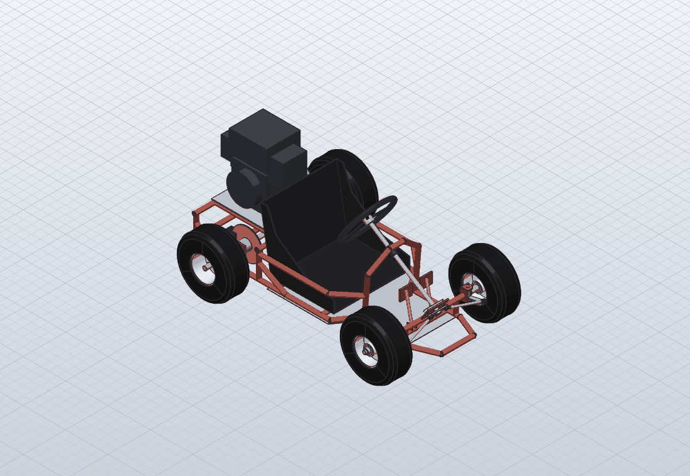
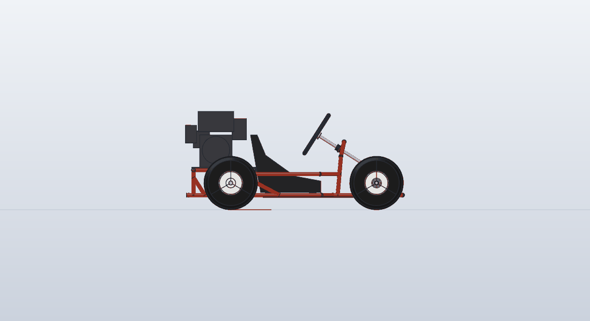

# Youth off-road go-kart: welded 25 × 2 steel tube frame

A complete, buildable go-kart modelled in SolidCraft. It was designed from an AI-generated concept
sketch ("marco tubular para go-kart"). That sketch had many errors, listed below; this design keeps
its idea of a small welded tube kart with off-road tyres and corrects everything needed for it to
work and be built.

| File | What it is |
|---|---|
| `gen_kart.py` | Parametric generator: every dimension is at the top. It writes `go_kart.json`, `cut_list.csv` and `bom.csv`. |
| `go_kart.solvecraft` | The complete design: open it in SolidCraft (`solvecraft go_kart.solvecraft`) |
| `go_kart.json` | SolidCraft command script that builds it: 467 commands, 124 bodies |
| `cut_list.csv` | Tube cut list with the end preparation (cope or mitre) for each tube |
| `bom.csv` | Bill of materials: everything to buy, fasteners, tube, plates and machined parts |
| `iso.png`, `side.png` | Renders made with `solvecraft-cli snapshot` |

```sh
python3 gen_kart.py                                   # regenerate after changing a parameter
solvecraft-cli run go_kart.json --save go_kart.solvecraft --out go_kart.step
solvecraft-cli snapshot go_kart.json --out iso.png --view iso
```

Axes: X points forward (the driver faces +X), Y points left, Z points up. The ground is Z = 0 and
the rear axle lies on the Y axis at X = 0. Units are mm.




## 1. Errors in the concept sketch, and the corrections

| # | Error in the sketch | Why it is a problem | Correction in this design |
|---|---|---|---|
| 1 | **Rear axle "Ø12 mm"** | Each rear wheel carries ≈ 380 N about 100 mm from its bearing, which gives about 115 N·m with a ×3 bump factor. Ø12 gives σ ≈ 680 MPa in bending and τ ≈ 230 MPa under engine torque: it bends or breaks. | **Ø25 h9 C45 live axle**: σ ≈ 75 MPa, τ ≈ 25 MPa, safety factor > 4. Runs in UCFL205 bearings. |
| 2 | **Dimensions disagree**: width is given as both 60 cm and 55 cm, and the tyres are drawn outside a frame that would then be only about 30 cm wide | There is no room for a seated driver. A track that narrow tips over in a turn. | Rear track 760 mm and front track 640 mm; overall width 887 mm. Static rollover threshold ≈ 1.3–1.4 g, so the kart slides before it tips. |
| 3 | The **"12 mm" callout points at a frame tube** | This contradicts the parts list, which says the frame is Ø25 tube. | The whole frame is 25 × 2.0 tube (EN 10305-3 E235, or 1" × 14 ga DOM). |
| 4 | **Handlebar with no steering mechanism**: no column, kingpins, stub axles, steering arms or tie rods, and the front wheels sit on a fixed axle | The kart cannot steer. | Steering wheel and column, pitman arm, two adjustable tie rods with rod ends, kingpin brackets, and welded knuckles with Ø20 stub axles. The steering arms point at the rear-axle centre (Ackermann geometry). |
| 5 | **Front frame passes through the space the front wheels sweep** | The front wheels hit the frame as soon as they steer. | The foot box narrows to ±150 mm. At **±30° lock** the tyre stops 15 mm from the frame; this was checked by rotating the corner about the kingpin in the model. |
| 6 | **Drivetrain missing**: a sprocket floats beside the seat with no engine, clutch, chain or mount | The kart has no drive. | Honda GX200 on a slotted plate, centrifugal clutch (10T #35), #35 chain of 92 links, and a 72T sprocket on a keyed hub. |
| 7 | **No brake, no pedals, no throttle** | Unsafe. | Mechanical disc brake (Ø180 disc) on the axle with a cable from a pivoting brake pedal. The throttle pedal pulls a cable to the engine. |
| 8 | **Rear axle has no bearings or mounts** | The axle would run in a frame tube. | Two UCFL205 flange bearings on 8 mm plates welded to the rails. |
| 9 | **"Joint detail" shows 5–6 tubes meeting at one point** | Impossible to fit up and weld well; the joint would be weak and full of heat cracks. | At most two tubes are coped onto a through-tube at any node. Crowded nodes are offset by ≥ 25 mm (rear uprights at X = −230, side rail at Z = 220, braces moved off the cross-tube stations). |
| 10 | **Seat and floor pan are not attached** to anything | Unsafe. | Bucket seat bolted to welded tabs on the seat crosses (4 × M8, 254 × 273) and through its back to two tabs on the deck cross; a 1.5 mm floor pan riveted or stitch-welded under the rails. |
| 11 | The hoop around the seat looks like roll protection but is **lower than the driver's head** | It gives false confidence. | It is not claimed as roll protection. The kart is a low, wide, open kart: helmet required, no seat belt, as in normal karting. |
| 12 | **Top and side views do not match the 3D view** (different tube layouts and wheel sizes) | The drawing cannot be built as drawn. | A single 3D model; every view and the cut list come from it. |
| 13 | **Parts list incomplete**: no tyre size, bearings, chain, fasteners, steering or brake parts | The kart cannot be ordered or built from it. | Full list of commercial parts (section 3) and list of parts to make (section 4). |

## 2. Main data

| Item | Value |
|---|---|
| Driver | Youth, about 130–160 cm tall, ≤ 60 kg |
| Overall L × W × H | 1352 × 887 × 608 mm (top of the fuel tank) |
| Wheelbase / track (rear, front) | 900 / 760, 640 mm |
| Tyres | 13x5.00-6 (Ø330 mm), axle height 165 mm |
| Ground clearance | Frame and floor pan 76 mm; chain guard 48 mm (lowest point) |
| Engine | Honda GX200 QX, 5.5 hp, governed at 3600 rpm, 3/4" keyed shaft, 16.1 kg |
| Seat | Universal high-back plastic bucket seat, 450 × 355 × 370 mm |
| Final drive | 10T / 72T #35 (ratio 7.2), **≈ 31 km/h** at 3600 rpm; 92-link chain at 223.1 mm centres |
| Steering | Ø280 wheel, column at 32.5° to horizontal, ±30° lock, Ackermann steering arms 80 mm long |
| Frame | 25 × 2.0 steel tube, **11.0 m** cut length, 38 pieces (≈ 12.5 kg); plates 1.5–8 mm |
| Estimated dry mass | ≈ 70 kg. The model reports 93 kg because the rims and the engine are solid envelopes; the BOM gives catalogue masses. |

**Faster or more ground clearance:** a 60T sprocket raises the lowest point to about 70 mm, but the
top speed rises to ≈ 37 km/h, which is too fast for a youth kart. Bigger tyres (16x6.50-8) need a
jackshaft to keep the speed down. Both are owner decisions; the parameters are at the top of
`gen_kart.py`.

## 3. Engine, seat and the bill of materials

**`bom.csv` is the bill of materials:** 63 lines covering bought parts, fasteners, tube, plates and
machined parts, with quantities, standards and notes. `gen_kart.py` generates it together with the
model, and the generator stops if a modelled part is missing from the BOM or a quantity disagrees
with the number of bodies in the model.

**Engine: Honda GX200 QX (GX200UT2QX2)**, a 196 cc OHV engine giving 5.5 hp at 3600 rpm (governed).
- It has a 3/4" × 2-7/16" keyed shaft, measures 313 × 376 × 346 mm and weighs 16.1 kg dry.
- It suits a youth kart: it is governed, reliable, sold and serviced worldwide, and it takes the
  standard 3/4" 10T #35 kart clutch directly.
- These engines use the same mounting base and shaft and fit the plate without changes:
  - Predator 212 non-hemi, which uses 5/16-24 bolts
  - Loncin G200F
- The model is an envelope at the catalogue size: crankcase, cylinder, fuel tank, muffler at the
  rear, air cleaner toward the seat, recoil starter and PTO shaft.
- The mounting pattern is 4 × M8 on 162 × 75.5 mm. The plate slots give ±15 mm of chain
  adjustment.
- **Mark the slots from the engine you buy before cutting.** Published drawings do not make it clear
  which direction the 162 mm runs.
- The generator picks the shortest even chain (92 links of #35) that keeps the air cleaner 41 mm
  behind the seat back. It then places the engine where that chain fits with the slots centred:
  223.1 mm between sprocket centres.

**Seat: universal high-back plastic (HDPE) go-kart bucket seat**, about 450 W × 355 H × 370 D.
- It is the widely sold replacement seat for karts, buggies and drift trikes (e.g. YC Yier and
  similar), with 4 mounting holes on 254 × 273 mm (10 × 10-3/4 in).
- It is chosen over a racing seat because its back is upright enough (about 10° recline) to sit in
  front of the engine. A racing seat such as the Tillett T11 has its back reclined 58° and would
  reach the engine.
- It is modelled as a 5 mm shell with side bolsters. It sits on four seat tabs (P08) placed under
  its holes, and bolts through the back to two tabs (P09) on the deck cross.
- The frame was adapted to it:
  - The seat crosses (F07, F08) sit under its holes.
  - The side rails stay at ±250 mm beside the seat, then a second rail (F24) mitres in to the hoop.
  - The rail taper starts at X = 560.
- Check the hole pattern when the seat arrives. If it differs, move the tabs, which are welded on
  last.

### Using the vendor STEP models

Vendor CAD files are not stored in this repository because their licences do not allow
redistribution. Download them yourself, then build the kart with them in place of the envelopes:

```sh
python3 gen_kart.py --engine-step GX200.step --engine-rot "Z:90" --engine-pto "x,y,z" \
                    --seat-step seat.step --seat-rot "Z:-90" --out go_kart_vendor.json
solvecraft-cli run go_kart_vendor.json --save go_kart.solvecraft --out go_kart.step
```

- `--*-rot` turns the file into kart axes in 90° steps about the world axes. Kart axes are X
  forward, Y toward the chain side (the engine's PTO end), and Z up.
- The engine is placed with its base on the plate and its PTO end where the clutch expects it.
  `--engine-pto` is any point on the shaft axis in the file's own coordinates; with it, the shaft
  sits exactly on the clutch axis. The generator warns if the file's shaft height differs from
  `CRANK_H`.
- The seat is placed with its underside on the seat tabs, its front edge at X = 555 and centred
  across the kart.
- The BOM check counts the imported bodies, then run the clash check
  (`inspect.interference`) again.

## 4. Parts to make

**Frame tubes**: see `cut_list.csv`. The table gives the length to the long point, and for each
end the cope angle and depth or the mitre angle. Tubes meet node to node in the model, so the copes
are calculated rather than modelled. Cut the copes with a hole saw or a printed paper wrap. F01
(rear rails) and F15 and F16 (deck crosses) run 12.5 mm past the last joint and get end plugs.

**Plates** (laser-cut S235; sizes from the model):

| # | Part | Size | Holes / notes | Qty |
|---|---|---|---|---|
| P01 | Floor pan | 700 × 525 outline, 1.5 mm | Follows the rails | 1 |
| P02 | Rear bearing plate | 150 × 157 × 8 | Ø45 centre, 2 × Ø12 at 99 mm (UCFL205) | 2 |
| P03 | Kingpin back plate | 40 × 62 × 6 | Welds to the end of the front axle beam | 2 |
| P04 | Kingpin ear | 40 × 39 × 6, R20 end | Ø12.2, ears 50 mm apart | 4 |
| P05 | Engine plate | 390 × 300 × 5 | 4 slots 8.5 × 30 on the engine's pattern | 1 |
| P06 | Chain guard | 1.5 mm, follows the chain | Ø66 hole for the axle hub; fold a 15 mm lip | 1 |
| P07 | Caliper bracket | 80 × 92.5 × 6 | 2 × Ø8.5 (match the caliper) | 1 |
| P08 | Seat tab | 40 × 30 × 4 | Ø8.5, under the seat holes (254 × 273) | 4 |
| P09 | Seat-back tab | 30 × 34 × 4 | Ø8.5, bolts through the seat back | 2 |
| P10 | Column upper bracket | 50 × 55 × 6 | Ø20.5 | 1 |
| P11 | Column lower bracket | 120 × 65 × 6 | Ø30 + 2 × Ø10.5 at 90 mm (UCFL204) | 1 |
| P12 | Pedal clevis tab | 30 × 25 × 4 | Ø8.5 | 4 |
| P13 | Pedal pad | 70 × 60 × 8 | Knurl or weld beads for grip | 2 |

**Machined parts:**

| # | Part | Material | Work | Qty |
|---|---|---|---|---|
| M05 | Rear axle | Ø25 h9 C45 bright bar, 860 long | Keyway 8 × 4 at the hubs, sprocket and brake; 1 × 45° chamfers | 1 |
| M01 | Knuckle sleeve | 22 × 4 tube (S355), 48 long | Ream 14 H7 for the flanged bushes after welding | 2 |
| M02 | Stub axle | Ø20 S355 bright bar, 162 long | Saddle onto the sleeve; M20 × 1.5 thread 25 long; Ø3 cotter-pin hole | 2 |
| M03 | Steering arm | 6 mm plate | Ø8.2 hole; weld to the sleeve 2 mm above the lower ear | 2 |
| M04 | Stub-axle spacer | 28 × 4 tube, 44.5 long | Face both ends square | 2 |
| M06 | Steering column | 20 × 2.5 tube, 510 long | Wheel hub at the top; pitman arm welded 12 mm from the bottom | 1 |
| M07 | Pitman arm | 6 mm plate | Ø20.5 + 2 × Ø8.2 at ±45 | 1 |
| M08 | Tie rod | Ø12 bright bar, ≈ 165 long | Tap M8 right-hand at one end and M8 left-hand at the other, 20 deep; jam nuts. Set toe-in to 0–2 mm. | 2 |
| M09 | Pedal arm | Ø16 × 2 tube, 171 long | Weld a Ø8.5 pivot boss at the bottom and the pad at the top | 2 |

## 5. Assembly and welding notes

1. **Jig the bottom frame flat.** Clamp F01–F05 on a flat table and tack the mitres. Then fit the
   crosses F06–F10, which are coped onto the rails. Check the diagonals agree within 2 mm before
   welding out.
2. **Rear deck.** Weld uprights F13 and F14, then the deck crosses F15 and F16 (capped ends), the
   deck rails F17, and the braces F18 and F19.
3. **Bearing plates P02.** Weld them to the outer side of the rails with a Ø25 rod through both
   bores, so the bearings line up.
4. **Front axle beam F12.** Weld the kingpin back plates and ears with an M12 rod through both
   pairs of ears, so the kingpins are parallel and vertical. Then fit F12 onto the front uprights
   F11.
5. **Hoop and side rails.** Weld F20–F24, then the column brackets P10 and P11 with the column in
   place and the UCFL204 bolted on.
6. **Weld in short, alternating runs** (MIG/MAG, 0.8 mm wire). Leave the frame to cool on the jig,
   then check the axle and kingpin alignment again. Drill a Ø3 vent hole in each closed tube
   section.
7. **Knuckles.** Weld the stub axle M02 square to the sleeve M01 in a fixture, then the steering
   arm M03. Ream the sleeve to 14 H7 after welding.
8. **Drivetrain.** Line up the sprocket with the clutch using a straightedge (chain line at
   Y = +180). Fit the 92-link chain and slide the engine in its slots until the chain has 10 mm of
   slack.
9. **Before the first drive.** Brake test, with the brake cable stop set so the pedal stays firm.
   Check every nylock nut and every set screw (with Loctite 243), and fit the chain guard.
10. **Finish.** Degrease and powder-coat or paint the frame.

**Safety:** this is an off-road recreational vehicle. Use it only with a helmet, on private ground,
with adult supervision. Keep the engine governor; the 72T gearing is chosen for about 31 km/h.

## 6. How the design was checked (SolidCraft)

- The whole assembly (124 bodies) rebuilds from `go_kart.json` with no errors. It saves, reopens,
  and exports to STEP.
- **Engine and seat:** a clash check of the engine, seat, clutch, chain, guard, engine plate, seat
  tabs, rear deck, seat crosses, side rails, rear wheels, bearings and steering wheel found nothing
  except the chain meshing with its sprockets and the steering wheel's own parts. The air cleaner is
  41 mm behind the seat back.
- **Clash check** (`inspect.interference`) over the whole assembly: the only overlaps reported are
  weld joints (frame nodes, plates on tubes, knuckle welds), the chain meshing with its sprockets,
  parts that are made as one piece (steering-wheel spokes, pedal pads), and bolted stacks.
  No moving part touches the frame.
- **Steering lock:** the left front corner (knuckle, wheel, bearings and rod end) was rotated ±30°
  about the kingpin and checked against the frame, floor pan, column brackets and pitman arm. The
  only contacts reported were weld joints, and the tyre clears the frame by 15 mm.
- Strength checks (hand calculations, ×3 dynamic factor):

  | Part | Stress | Safety factor |
  |---|---|---|
  | Rear axle | 75 MPa bending, 25 MPa torsion | > 4 |
  | Stub axle (Ø20 S355) | 87 MPa | 4 |
  | #35 chain | 780 N pull against ≈ 7.8 kN breaking load | 10 |

**Known limits of the model:**
- The SolidCraft kernel cannot yet make booleans between angled cylinders, so tube copes are given
  in the cut list instead of being modelled.
- Commercial parts are modelled at catalogue size but simplified: engine, seat, tyre, rim, caliper
  and bearings. The engine's mounting orientation and the caliper bolt pattern must be checked
  against the parts actually bought.
