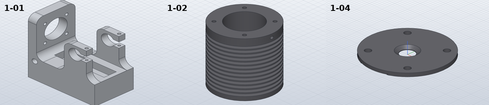

# Build the modelling pipeline and the first parts

*Activity 02 · 2026-10-25*

**A parametric generator that writes SolidCraft scripts and checks every part against a hand-computed volume was built, the first five motor parts (1-01 to 1-04, 1-09) were modelled with it, and a SolidCraft bug that makes blind holes 3.42 mm short was found and worked around.**

## Aim

With the scope settled (activity 01), the work was to model single parts of the Lanz motor in SolidCraft. A part can look right in a render and still be wrong by a feature, so each part needed a check that does not depend on looking: the volume computed by hand from the drawing dimensions must agree with what SolidCraft measures.

Done meant: for each part a `.json` command script, a saved `.solvecraft` design, a STEP export and a snapshot; one valid solid; and SolidCraft's volume within 0.1 % of the hand value. The repository rules applied: assets attributed in `ATTRIBUTION.md`, nothing pushed that fails `cargo xtask assets`.

## Tools

| Tool | Version | Used for |
| --- | --- | --- |
| SolidCraft `solvecraft-cli` | repo build (release) | `run`, `eval`, `snapshot`, `commands`: building and measuring parts |
| Python | 3.13 | `gen_parts.py`, the generator and checker |
| solid-modeling skill | — | Workflow: parameter table, plan, estimate, verify |
| poppler `pdftoppm` | system | High-resolution crops of sheet 03 to read dimensions |
| `cargo xtask assets` | repo | Checks every PNG/STEP has an `ATTRIBUTION.md` row |

## Process

### 1. Learning the command set

`solvecraft-cli commands` lists every command with its parameters. A first probe showed that the XZ sketch plane maps sketch-y to −Z, so all sketches were afterwards placed with an explicit `{origin, x_dir, y_dir}` frame.

```bash
../../target/release/solvecraft-cli eval $S/t.json
```

Output: `error: step 5 (solid.hole): invalid parameters for solid.hole: no planar face at position; give direction` — the ring had come out at Z = 0…−10, not 0…10.

### 2. The generator and its check

`gen_parts.py` holds one function per part. Each function adds named parameters (with the drawing dimension they come from), builds the features and returns the volume worked out by hand. The driver writes the script, runs SolidCraft, and compares.

*The part registry and the check, trimmed*

```python
@part("1-02", "Motor cylinder", "Cast Iron")
def motor_cylinder(s):
    L = s.param("cyl_length", 71, "overall length (1-02)")
    ...
    return v - 4 * tap * (in_metal(0, HD) + in_metal(L - HD, L)) - radial

ok = len(bodies) == 1 and not errors and abs(dv) < 0.001 and (open_edges or abs(dm) < 0.005)
```

A second, independent check reads the volume of the exported STL mesh with the divergence theorem; it is skipped when the mesh is not closed.


*Figure 1 — How a part goes from the generator to a checked model*

> The hand volume bypasses SolidCraft entirely (the lower arrow), which is what makes the comparison meaningful. A part only enters `summary.json` and the README table if the check passes.

### 3. The cylinder, and a wrong theory

1-02 is a finned cylinder: one revolved half-section, 4 × M4 × 10 tapped holes at each end, a radial oiler hole. Its first volume was 0.25 % above the estimate. Measuring the cut of one hole at a time gave numbers that looked like a bug in SolidCraft's volume measurement (a 5 mm deep hole removing 33.6 mm³ where 42.8 was expected), and the owner was told so.

That theory was wrong. The PCD holes lie outside the fin root, so a 10 deep hole only removes metal where it crosses the flange and a fin. With the estimate corrected, SolidCraft agreed to 0.001 %; the leftover per-hole differences were within SolidCraft's tessellation-based measuring noise (about 0.02 %). The claim was withdrawn in the next message.

Output: `1-02: OK hand volume 60778.9 mm³, mesh 60728.6 (-0.08 %), SolidCraft 60778.4 (-0.00 %)`

### 4. The motor frame and the short holes

1-01, the aluminium frame, came in 0.14 % over. Volumes per feature showed three of the four M6 × 25 and two of the M4 × 10 holes removing too little. Listing the hole bottoms made it plain:

```text
17.5 [12.0, -16.0, 25.0]
17.5 [12.0, 16.0, 21.576]
17.5 [84.0, -16.0, 21.576]
7.623 [88.5, 24.0, 6.576]
```

*Figure 2 — Hole-bottom faces (area, centroid) of 1-01 after `solid.hole`*

> The first M6 hole ends at Z = 25 as asked; the others end at 21.576, exactly 3.424 mm short. The timeline showed the cause: "Boolean retry: temporary coincident-face separation up to 3.423684e0 mm per face" — the separation was never undone. The same holes on a plain box came out right, so the bug needs this body's history to show.

Putting each hole pattern into one sketch of circles and cutting it with one extrude gave correct depths, and is also the cleaner feature tree. A `holes()` helper replaced every `solid.hole` call, and the checker now treats any "separation" retry as an error.

### 5. Reading the drawing closely

The frame's views were read at 400 dpi: cheeks 9 thick at Y = ±19…28, a Ø19 crankshaft bore at X 68, Z 70, a 10 mm clamp slot, a crank pit 71.5 × 18 from section A-A. Joining separate cheek extrudes left seam lines, so the frame was rebuilt as one full-width extrude of the side profile with the gap between the cheeks pocketed out.

1-04's channel detail was read as a 20 wide, 0.5 deep channel with 0.5 wide, 1 deep grooves along its edges and a Ø10 port countersunk to Ø15. Its STL had 9 open edges (a SolidCraft export crack), so the mesh check skips open meshes.



*Figure 3 — The frame, the cylinder and the inner head as built*

> In 1-01 the two 9 mm bearing cheeks with their Ø19 bores and clamp slots stand on the base, with the Ø33 cylinder bore in the upright. 1-02 shows 12 fins between the 5 mm and 9 mm flanges, with the oiler hole in the thicker one.

## Results

Five parts committed and pushed (`c5fad89`), each with script, design, STEP and PNG, and 10 rows added to `ATTRIBUTION.md` (`assets: 37 asset file(s), all attributed`).

- 1-01 frame 603.1 g, 1-02 cylinder 437.6 g, 1-03 gasket 6.4 g, 1-04 head 53.6 g, 1-09 glass 1.0 g.
- All within 0.01 % of their hand volumes.
- One SolidCraft bug found (holes 3.42 mm short after a separation retry) and avoided.

### Limits and what was left

- 1-01's small oil holes, the Ø6 × 15 holes of the plan view and the nut pockets were not modelled; the bottom view's projection (which side the M4 pair is on) is an assumption.
- 1-05 was skipped for lack of a thickness (done later, activity 04).
- The SolidCraft bug was reported, not fixed.

---

*Written retrospectively from the session transcript*
