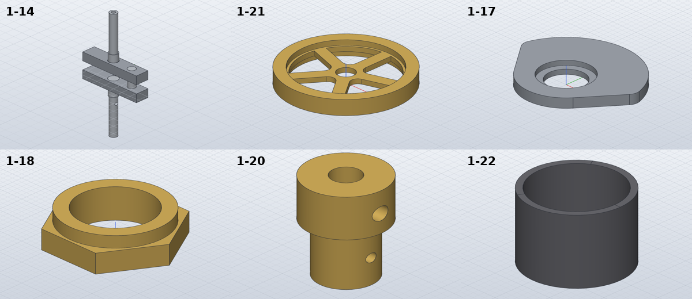

# Model the crankshaft, flywheel, piston and valve gear

*Activity 03 · 2026-10-29*

**Eleven moving motor parts (1-14 to 1-31) were modelled, the generator gained multi-body parts and a self-updating parts table, undimensioned sizes were measured from the PDF's own vector lines, and the hand-volume check caught a wrong formula in the checker itself.**

## Aim

After the first five parts, the owner said "Go on". The next parts on sheet 03 were the ones that move: the crankshaft, its pulley, cam plate, nut and spacer, the flywheel and its hub, the piston, and the valve gear's bush, shaft, rod and arm. Several of them raised new problems: the crankshaft is five pressed-together pieces of different materials, and some sizes (the crank throw, a pin length) are drawn but not dimensioned.

Done meant the same check as before (one solid per piece, SolidCraft's volume within 0.1 % of the hand volume), a README table that keeps up with the parts, and no size guessed from pixels where the drawing's geometry could be measured.

## Tools

| Tool | Version | Used for |
| --- | --- | --- |
| SolidCraft `solvecraft-cli` | repo build | Building, measuring, snapshots, `model.faces` |
| `pdftocairo -svg` | poppler | Turning sheet 03 into vector paths |
| Python | 3.13 | `segs.py` / `circles.py` (path parsing, circle fits), `gen_parts.py` |
| PIL | system | Crops and contact sheets of renders |

## Process

### 1. Reading the parts

Sheet 03 was rendered at 400 dpi and cut into tiles. Most parts read cleanly: the flywheel (Ø110 × 19 rim, 6 thick web, five 10 wide spokes with R6.5 window corners whose centres lie on the Ø39 circle), the hub (M16 × 19.5, Ø22 × 15, Ø8 bore), the cam plate (R25 lobe, R16 base, flanks at 37.5°, R4 corners). The crankshaft view gave the shafts (Ø10 press fit through 12 thick webs, Ø9.5 × 10.5 journal, Ø8 × 54, M5 ends) but no side view of the webs.

### 2. Measuring from the vector lines

SolidWorks exported the sheets as vector PDFs, so every line has exact coordinates. The sheet was converted to SVG and its paths parsed into segments.

```bash
pdftocairo -svg .../48413f4d-lanz-a3-sheet-03_.pdf $S/svg/s03.svg && python3 $S/segs.py $S/svg/s03.svg $S/s03_segs.json
```

Output: `28015` segments. A first circle search found nothing, because the PDF draws circles as polylines, not curves; `circles.py` fits a circle to each closed polyline instead.

```text
H [(345.56, 714.73, 731.72, False), (356.96, 714.73, 731.72, False), ...
   (351.2, 696.38, 750.22, True), ... (375.65, 748.72, 763.61, False), ...
   (389.15, 748.72, 763.61, False), ...]
```

*Figure 1 — Horizontal lines near the crank, as (y, x from, x to, dashed) in points (1:2, 1.4173 pt per mm)*

> The pin's outline is at y = 345.56 and 356.96: 11.40 pt, Ø8.04, which confirms the scale against a known diameter. Its dashed axis is at 351.2; the Ø9.5 journal's outline (375.65 and 389.15) is centred on 382.4. The throw is (382.37 − 351.26) / 1.4173 = 21.95, so 22 (a 44 mm stroke). The webs' width has no line anywhere on the sheet, so 14 was estimated from the 3D view and made a parameter, `crank_web_w`.

The same method gave the piston rod's cross pin (27 long) and the pulley's V-groove (4 wide at the top, 2.5 at its Ø20 bottom).

### 3. Multi-body parts and a parts table

The crankshaft became five named bodies: two webs, a crankpin and two shafts, each with its own material. The registry now accepts a dict of materials, the check expects that many bodies, and each built part goes into `parts/summary.json`, from which the README table between `<!-- parts -->` markers is rewritten. The same step adds missing `ATTRIBUTION.md` rows for new PNG and STEP files.

*Material per body for the crankshaft*

```python
@part("1-14", "Motor crank shaft", {"web L": "Steel", "web R": "Steel", "crank pin": "Stainless Steel",
                                     "shaft L": "Stainless Steel", "shaft R": "Stainless Steel"})
```

### 4. The check caught the checker

A helper `turned()` revolves an (r, z) polygon and returns its volume by Pappus's theorem. The first build of the batch failed almost everywhere:

```text
1-28: FAIL 1/1 bodies, hand volume 3150.0 mm³, STL mesh 1168.2 (-62.92 %), SolidCraft 1181.0 (-62.51 %)
```

SolidCraft and the mesh agreed with each other, and a Ø4 × 94 rod is 1181 mm³, so the hand formula was wrong. It used the second-moment term `(x0² + x0·x1 + x1²)` where the first moment needs `(x0 + x1)`. After the fix all eleven parts passed. Without an independent check, this would have shipped as wrong masses in the table.

### 5. Looking at the result



*Figure 2 — Six of the eleven parts as SolidCraft renders them*

> The crankshaft (top left) shows the two webs with the pin between them and the Ø4 cross hole in the lower shaft. The flywheel shows five spokes and the 2 mm lip left between the windows (Ø86) and the rim (Ø90), as the section shows. The cam plate's R25 lobe and the nut's Ø19 collar on the hex can be checked against the drawing directly.

## Results

Pushed as `566005d`: 1-14, 1-17 to 1-22, 1-26 to 1-28 and 1-31, each with script, design, STEP and PNG.

- All within 0.02 % of their hand volumes; the crankshaft has 5 bodies (227.8 g), the flywheel weighs 630.6 g in brass.
- The generator handles multi-body parts, writes the parts table and the attribution rows itself.
- Undimensioned sizes are measured from the vector lines: throw 22, pin 27, groove 4/2.5/Ø20.

### Limits and what was left

- The crank web width (14) is an estimate; the web ends (34.5 and 30 from the main axis) are measured but their corner radii are not modelled.
- The flywheel's window corners at the rim are sharp; the drawing rounds them without a radius.
- Threads are modelled at their tap drill (internal) or major diameter (external), not as helices.

---

*Written retrospectively from the session transcript*
