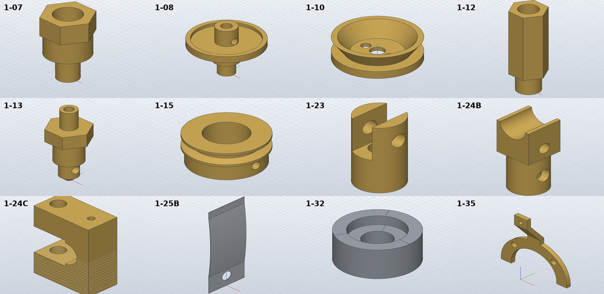

# Finish the sheet-03 motor parts

*Activity 04 · 2026-10-29*

**The remaining nineteen motor parts on sheet 03 (oiler, big end, slide valves, valve holder, cam follower, exhaust bracket) were modelled, part names were corrected against the parts list, and a SolidCraft limit with tangent faces was found and avoided.**

## Aim

Activity 03 left the small parts of sheet 03: the cylinder oiler (base, glass base, glass top, oil channel, oil valve), the outer head, the bearing, the connecting rod and its two-piece big end, the slide valves, the valve rod parts, the cam follower and the exhaust pipe bracket. They are small but fiddly: hexes on turned bodies, a 15° drain hole, a 0.1 mm bowed spring sheet, a sheet bracket with a joggle.

Done meant every sheet-03 part modelled and checked, except where the drawing truly leaves a part undefined, with each reading written down.

## Tools

| Tool | Version | Used for |
| --- | --- | --- |
| SolidCraft `solvecraft-cli` | repo build | Building and measuring parts |
| `pdftoppm` (600 dpi), `pdftocairo -svg` | poppler | Reading dimensions; vector lines for undimensioned sizes |
| Python | 3.13 | `gen_parts.py`; numeric volume of hole intersections |
| `pdftotext` | poppler | The parts list on sheet 02 |

## Process

### 1. Reading the big end

The connecting rod's big end is two brass parts. Reading the views at 600 dpi and lining up their dimensions settled it: 1-24B is a Ø10 × 12 socket on a 10 × 10 × 11 block ending in half of the Ø8 crankpin bearing; 1-24C is a U-shaped cap whose two 8 thick arms close over the block. Both carry a hole 3.5 from the same face, which confirmed they belong together. The cap's screw holes became Ø4.3, the M4 clearance that sheet 02's note 3 asks for (5–8 % over the tapped size).

### 2. Correcting names from the parts list

Two parts had been named from their shape. The parts list said otherwise:

```bash
pdftotext -layout .../478a0380-lanz-a3-sheet-02.pdf - | grep -oE "LANZ-1-[0-9]+[A-Z]?-[A-Z0-9 -]+"
```

```text
LANZ-1-29-MOTOR VALVE ROD LOCK NUT
LANZ-1-30-MOTOR VALVE ROD VALVE HOLDER
```

The fit confirmed the list: 1-30's Ø5 spigot carries the slide valves, which have Ø5 holes.

### 3. Hexes on turned parts

The first build of 1-07 (an 8 mm hex on a Ø8 collar) stopped:

```text
error: step 16 (solid.extrude): boolean Union: … not supported yet: the exact fallback for where
the bodies meet (faces that touch, or cross at a shallow angle) takes planar faces only
```

An 8 mm across-flats hex has an inscribed circle of exactly Ø8, so the collar touches all six flats along a line. The part was rebuilt the way it is machined: hex bar first, the collar turned down with a revolve cut, the stud overlapping 1 mm into the body, then the bores.

1-24B (a Ø10 socket on a 10 × 10 block) failed both ways. Butted together it gave two bodies; turned down from square bar, the third-party kernel panicked. SolidCraft's guard caught that and reported it as an error, with no crash:

```text
error: step 17 (solid.revolve): boolean Cut: … kernel internal error: boolean: called `Option::unwrap()` on a `None` value
```

A small test settled the fix: with the socket overlapping 0.5 mm into the block, the exact Ø10 joins cleanly.

```text
10 1 [2042.31] []
9.98 1 [2038.54] []
```

Output: the union is one body at 2042.31 mm³ (exact: 2042.48).


*Figure 1 — Why the hex parts failed, and what worked*

> The six dots mark where the Ø8 round only touches the hex's flats. A round butted or turned down to exactly that size meets this degenerate contact; overlapping the solids gives SolidCraft a normal intersection instead.

### 4. Odd shapes: the drain hole, the bowed spring, the joggle

1-08 was read entirely from the vector lines: a Ø4 nozzle, an M6 × 5 thread, a Ø17 flange with a Ø15 × 1 recess for the glass, an M3 boss, and a Ø2 drain hole rising at 15° from the bore into the recess. That hole's volume has no closed form, so the checker samples a grid inside the hole cylinder and counts points inside the revolved body (`removed_by_cylinder`).

1-25B, the 0.1 mm slide-valve spring, has an R162 bow over its middle 36 mm. Its sagitta works out at 1.0, which with the 0.1 sheet matches the drawn 1.1 overall depth. 1-35's joggle was built as a polyline offset by the thickness, with mitred corners.

### 5. Builds and renders

All nineteen passed, most within 0.01 %. SolidCraft took several minutes to measure 1-24B, so the builds ran in the background.



*Figure 2 — Twelve of the nineteen parts*

> 1-08's drain hole is visible in the boss; 1-10 is the funnel with its two feed holes; 1-24B shows the half bearing with the pin and screw holes; 1-24C is the U-shaped cap; 1-25B is visibly bowed; 1-35 shows the 10.5 joggle between the tab and the fork.

## Results

Pushed as `5f36dd7`: 1-05 to 1-08, 1-10 to 1-13, 1-15, 1-23 to 1-25B, 1-29, 1-30, 1-32, 1-33 and 1-35. With activity 03, sheet 03 was complete except 1-34.

- Every part within 0.1 % of its hand volume.
- Names checked against the parts list.
- Hex and square parts built in an order SolidCraft can handle.

### Limits and what was left

- 1-05's thickness is not on the drawing; 3.5 was taken from 1-04 ("refer to 1-04 for all dimension details").
- 1-06 is a bought ball bearing, modelled as an envelope.
- 1-08's 30° nozzle chamfer would leave a knife edge on the bore and was left out; 1-33's and the bolts' small notches and slots are not modelled.
- 1-34 (a wire spring) was deferred (done in activity 07).

---

*Written retrospectively from the session transcript*
