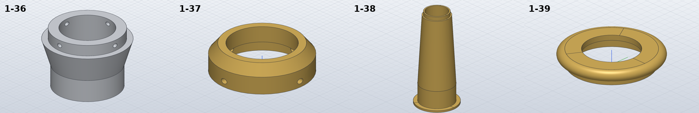

# Model the exhaust stack parts

*Activity 05 · 2026-10-29*

**The four turned parts of the exhaust stack on sheet 04 (1-36 to 1-39) were read from the drawing's vector lines and modelled, and the readings were confirmed by how the parts fit each other.**

## Aim

With sheet 03 nearly complete, work moved to sheet 04, starting with the exhaust stack, a set of four turned parts that stand on the motor: the lower circular bracket (aluminium), the base ring, the stack and its top ring (brass). All four are half-sections at 1:2 or 1:1.5, with some dimensions only implied by the drawing.

Done meant four checked parts whose sizes agree with each other where they mate.

## Tools

| Tool | Version | Used for |
| --- | --- | --- |
| `pdftoppm` (400 dpi), `pdftocairo -svg` | poppler | Viewing sheet 04; vector lines and fitted arcs |
| `vlines.py`, `circles.py` | session scripts | Listing lines in a region; fitting circles to polylines |
| SolidCraft `solvecraft-cli` | repo build | Building and measuring |
| Python | 3.13 | `gen_parts.py` |

## Process

### 1. Reading the lower bracket from its lines

The 1-36 section mixes a view on one half with a section on the other, so the solid lines inside its region were listed.

*The region filter, from the inline script (overview coordinates scaled to points)*

```python
x0,y0,x1,y1=20*f,30*f,125*f,230*f
L=[s for s in segs if s[0]=='L' and not s[3] and all(x0*k<=p[0]<=x1*k and y0*k<=p[1]<=y1*k for p in (s[1],s[2]))]
```

With the axis at x = 59.18 pt and 1.4173 pt per mm, the lines gave every radius: the Ø31 base (r 15.48) 14 high, a cone to Ø38.5 at Z 31, a Ø33 band 7 high, and inside a Ø27 bore up to 6.56 with a straight taper to Ø24 at the top. That taper is one line, `(76.57, 66.77) → (78.37, 104.25)`. Extended upward, it reaches r = 12.03 at the top face, so the bore is Ø24 there and the taper runs the whole way.

### 2. The base ring, and a check by fit

The same filter, saved as `vlines.py`, read the base ring:

```bash
python3 $S/vlines.py $S/s04_segs.json 265 20 400 150
```

1-37's lines gave a Ø40 × 10 ring with a 6 high cone up to Ø33, a Ø27 bore, and a Ø33 counterbore 7 deep from below. Its radial hole was found from two short lines:

```text
[250.21, 72.07, 246.01, 72.07]
[255.2, 74.96, 250.21, 74.96]
[250.21, 79.16, 255.2, 79.16]
```

*Figure 1 — Lines of the base ring's radial hole (x, y, x, y in points, 1:2)*

> The hole's edges at y = 74.96 and 79.16 are 4.2 pt apart: Ø3 at 1:2. Its centre at 77.06 is 3.46 mm above the bottom line (81.96), so 3.5. The step at y = 72.07 is the top of the Ø33 counterbore, 6.98 mm up: 7.

The numbers explained each other. The ring's Ø33 × 7 counterbore is exactly the size of the bracket's Ø33 × 7 band, and its Ø3 holes at 3.5 from the bottom line up with the bracket's M3 holes 3.5 below its top. So the ring sits over the band and is screwed through the side. The bracket's hole count is not drawn; dashed holes on both sides of its section and two visible in the 3D view gave four at 90°.

### 3. The stack and the top ring

1-38 is 100 high: a Ø33 × 2 flange, a Ø27 × 19 cylinder, a cone to Ø21 over 75 and a Ø19 × 4 band, with one straight bore taper from Ø24 to Ø17. 1-39 is a Ø26.5 bead with a full R2 round edge on a Ø22 × 2 spigot, bored Ø14.5 at the top and Ø19 below. That Ø19 bore again matches a mating size, the stack's Ø19 band.

The bead's round edge made the volume more than a polygon: the hand value adds the half-disc of the round by Pappus, with its centroid 2T/3π outside the edge's centre.

*Volume of the bead's half-round edge, added to the polygon's*

```python
half = math.pi / 8 * T * T
return revolved_volume(poly) + 2 * math.pi * (rb + 2 * T / (3 * math.pi)) * half
```

### 4. Building

```bash
timeout 900 python3 gen_parts.py --build 1-36 1-37 1-38 1-39
```

```text
1-36: OK   1/1 bodies, hand volume 12827.0 mm³, … SolidCraft 12826.8 (-0.00 %), mass 34.6 g
1-37: OK   1/1 bodies, hand volume 7624.6 mm³, … SolidCraft 7624.5 (-0.00 %), mass 64.8 g
1-38: OK   1/1 bodies, hand volume 14502.1 mm³, … SolidCraft 14499.7 (-0.02 %), mass 123.2 g
1-39: OK   1/1 bodies, hand volume 1364.0 mm³, … SolidCraft 1363.9 (-0.00 %), mass 11.6 g
```


*Figure 2 — The four profiles as modelled, drawn at one scale*

> These are the (r, z) polygons from `gen_parts.py`, right of each axis. The bracket's Ø33 band and the ring's Ø33 × 7 bore are the same size, which is how the two fit. The stack's bore is one straight taper over its full 100 mm.



*Figure 3 — The parts as SolidCraft renders them*

> The bracket shows its M3 holes in the band; the base ring its Ø3 holes near the bottom. The stack's cone and the top ring's rounded bead match the 3D views on the sheet.

## Results

Pushed as `dc7fe5f`: 1-36 (aluminium, 34.6 g), 1-37 (64.8 g), 1-38 (123.2 g) and 1-39 (11.6 g), all within 0.02 %.

- Every size read from the vector lines rather than estimated.
- The fits (band to counterbore, screw holes, Ø19 band to bore) confirm the readings independently.

### Limits and what was left

- The number of M3/Ø3 holes (4 at 90°) is inferred, not dimensioned.
- The stack's top is modelled flat; the drawing shows no other detail there.

---

*Written retrospectively from the session transcript*
