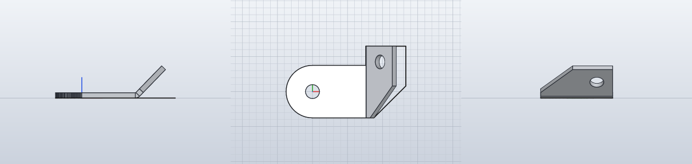
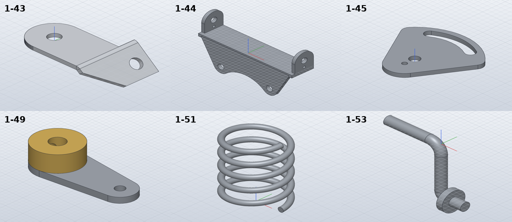

# Model the accelerator linkage and steering bracket

*Activity 06 · 2026-10-29*

**Eleven parts from sheet 04 (1-43 to 1-53) were modelled, using SolidCraft's sheet-metal tools for the folded bracket and its coil command for a spring, and a second SolidCraft bug (hidden sketches reappear after reopening) was found.**

## Aim

After the exhaust parts the owner said "go on" again. The next group on sheet 04 is the accelerator linkage and the top steering shaft bracket: a bent steel bracket with ears, a guide plate with a curved slot, a bridge shaft, three levers (one with a pressed-in hub), two bolts, a small spring, a cranked rod, and an aluminium bracket given only as a flat pattern with a 134° bend.

Done meant every part checked as before. The bent parts were to keep the drawing's flat dimensions where possible.

## Tools

| Tool | Version | Used for |
| --- | --- | --- |
| SolidCraft `solvecraft-cli` | repo build | `sheet.flange`, `sheet.fold`, `solid.coil`, `solid.pipe`, `browser.visibility` |
| `pdftocairo -svg`, `vlines.py` | poppler / session | Outline and hole positions of 1-44 and 1-52 |
| Python | 3.13 | `gen_parts.py`; a `link()` helper for the levers |

## Process

### 1. Reading the parts

The bracket 1-44 took three views to understand: a 2 mm strip, 14 deep, with ears turned up at the ends and a plate hanging from its front edge, ending in two R4.5 lobes round Ø4 holes joined by an R17.5 arc. Its vector lines gave the arc centre (32.2 below the strip) and the M2 hole (1.93 above it). The guide plate 1-45 uses the same flank-and-fillet construction as the earlier cam plate, with flanks at 30° tangent to an R7 round. The three levers share one helper: two rounded ends joined by outer tangents, a hole in each.

1-53 is drawn on sheet 04 but missing from the parts list:

```bash
for f in .../*.pdf; do pdftotext "$f" - | grep -o "LANZ-1-5[0-9][A-Z0-9 -]*" ; done | sort -u
```

Output: only 1-50, 1-51 and 1-52. It is modelled under its drawing number and named "Accelerator crank".

### 2. Sheet metal for the flat-pattern bracket

1-43 is drawn as a flat pattern. The command list showed sheet-metal tools:

```text
sheet.fold :: line: sketch + curve … or points: [[x,y,z], [x,y,z]]; angle? (default 90 deg); radius? …
```

A base flange from the drawn outline plus a 46° fold (180 − 134) was the right model, but the fold refused the drawn fold line three ways:

```text
error: … the bend zone (1.204 mm wide) reaches a corner of the sheet's outline at (15.200, 13.000, 1.500)
error: step 7 (sheet.fold): invalid input: sew: a degenerate edge
error: step 7 (sheet.fold): not supported yet: folds whose bend zone crosses a slanted or curved edge of the sheet
```

The tab's step lies exactly on the drawn fold line. With a 0.2 bend radius and the fold moved 0.43 mm past the step, the fold worked. With a K-factor of 0.5 (the neutral layer in the middle) sheet metal keeps its volume, so the hand value is just flat area × thickness:

Output: `762.953` mm³ against 762.98 by hand. The flange ignored the hole circles in the flat sketch, so the holes are cut into the flat sheet before the fold.

### 3. Three build failures in one batch

```text
1-43: FAIL … hand volume 725.3 mm³, … SolidCraft 763.0 (+5.19 %)
1-44: FAIL … hand volume 3632.8 mm³, … SolidCraft 3656.8 (+0.66 %), … box 62.00 x 14.00 …
1-53: FAIL error: step 16 (solid.cylinder): boolean Union: … faces pushed apart gave an implausible volume
```

Each had a plain cause. 1-43's extra 37.7 mm³ is exactly its two missing Ø4 × 1.5 holes. 1-44's box was 62 wide instead of 60: both ears had been extruded toward −X, so one sat outside the strip. 1-53's collar was butted against the end of the pipe's bend, so the rod was instead run straight on through the collar to the end of the stub, with the collar overlapping it.

### 4. Hidden sketches come back

The 1-43 snapshot showed a ghost outline beside the folded tab.



*Figure 1 — 1-43 rendered from its saved design*

> The solid is right: the right view shows the folded tab with its hole. The thin flat outline running on from the fold in the front and top views is the flat-pattern sketch, still visible.

Hiding it with `browser.visibility` reported `"hidden_sketches": [1]`, yet after saving and reopening it was visible again. A three-command test showed this is general:

```text
plain sketch after reopen: [{… 'name': 'K', … 'visible': True}]
plain sketch, script eval: [{… 'name': 'K', … 'visible': False}]
```

SolidCraft does not save sketch visibility. Snapshots are now rendered from the scripts. In the standard iso view the folded tab happened to be edge-on, so the fold was flipped to show its face.

### 5. The coil spring and a per-part tolerance

1-51 was built with `solid.coil` (Ø4.5 mean, 0.5 wire, 5 turns, 7 free length). It came in 0.48 % low: the measurement of a 0.5 mm wire from a tessellation is not good to 0.1 %. Parts may now carry their own tolerance; this one has 1 %, with the reason in a comment.



*Figure 2 — 1-43, 1-44, 1-45, 1-49, 1-51 and 1-53*

> 1-43 shows the tab folded down with its second hole; 1-44 the ears and the lobed plate; 1-45 the curved slot on R18; 1-49 the brass hub on the steel lever; 1-53 the rod running through its collar into the stub.

## Results

Pushed as `12bae39`: 1-43 to 1-53 except 1-40 to 1-42 (activity 07).

- All within 0.02 %, except 1-51 at 0.48 % (1 % allowed for its thin wire).
- 1-43 is a real sheet-metal part that SolidCraft can unfold.
- A second SolidCraft bug documented: sketch visibility is not saved.

### Limits and what was left

- 1-43's fold sits 0.43 mm from the drawn line; the drawing's sharp bend is a 0.2 radius.
- 1-44's bends are sharp solids, not sheet metal; its M2 hole is modelled at the Ø1.6 tap drill.
- 1-45's countersink and the bolts' screwdriver slots are not modelled; 1-51's 5 turns were counted on the drawing.

---

*Written retrospectively from the session transcript*
