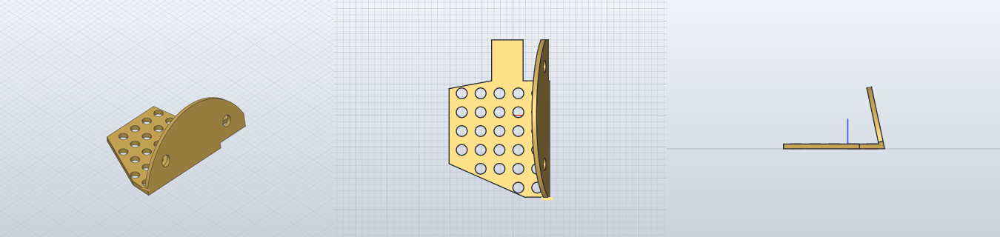
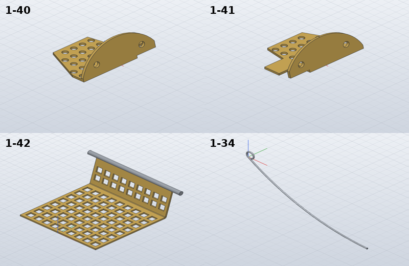

# Model the flame guards and the valve spring

*Activity 07 · 2026-10-29*

**The two perforated flame protectors (1-40, 1-41), the front flame guard (1-42) and the wire valve spring (1-34) were modelled, completing the motor group 1-01 to 1-53, after several construction approaches failed and a third SolidCraft bug (an inside-out pipe) was found.**

## Aim

These were the last four parts of the motor group, left for last because they are the hardest to build. 1-40 and 1-41 are mirror-image brass sheets 1.5 thick, drawn as a flat pattern with 26 perforations, a fold at 78° and an R28 end. 1-42 is a 0.5 mm perforated guard folded to 105° with a hinge rod. 1-34 is a Ø1 spring wire bent on R150 with an eye.

Done meant the same check as for every other part. The drawn geometry was to be kept, the sharp bend and the flat-pattern outline included.

## Tools

| Tool | Version | Used for |
| --- | --- | --- |
| SolidCraft `solvecraft-cli` | repo build | Extrudes and cuts, `sheet.flange` / `sheet.fold`, `solid.pipe`, `model.faces` |
| `pdftocairo -svg` + segment/circle scripts | poppler / session | The flat pattern, perforation grid and square-hole grid in mm |
| Python | 3.13 | `gen_parts.py` |

## Process

### 1. The flat pattern in millimetres

The 1-40 flat pattern was transformed into mm about the centre of the R28 arc. The perforations came out on an exact 6 mm grid (`[123.59, 381.4, 3.322], [134.92, 381.4, 3.324] …`, 11.33 pt apart at 1:1.5), in rows of 5, 5, 5, 5, 4 and 2. The outline matched the drawn dimensions 13.5 + 10 + 6.6 + 4.5 across the top. The fold line lies at X = 9.8.

### 2. Why SolidCraft's fold could not be used

The drawn fold line passes through the corner of the tab's step at the top, and the R28 arc starts 0.59 mm past it at the bottom. A bend zone of any useful width either contains that corner or crosses the curved edge, and `sheet.fold` refuses both (activity 06). The bracket therefore had to be built with a sharp bend from solids.

### 3. Three constructions that failed

Joining a flat leg, a folded leg and a mitre wedge failed in both orders:

```text
1-40: FAIL error: step 22 (solid.extrude): boolean Union: … the exact fallback for where the bodies meet
(faces that touch, or cross at a shallow angle) takes planar faces only, and the tool has 1 curved face (cylinder)
```

The legs share faces on the Y = −26 plane, and SolidCraft's fallback for touching faces only takes planar tools. The approach that worked builds one solid and only cuts it afterwards: extrude the whole bent cross-section across the part, then trim each leg to its outline.


*Figure 1 — The bent section and the order of the cuts*

> The shaded triangle is the mitred outer corner, the part a sharp bend adds beyond the two legs. Its exact area times the 37 mm length both legs share at the fold goes into the hand volume. Every later feature is a cut, so no two solids ever have to be joined.

That construction still failed twice, each time for a different reason:

- The perforation cut failed with "the target's face 15 could not be meshed", but only on 1-40, not on its mirror image. Cutting the perforations before the outline trims fixed it.
- The R28 trim left a zero-volume face. The part measured 51 wide instead of 50, and `model.faces` showed a face at Y = −26.5 with area 3.75. A second outline, meeting the strip's ends only at the arc's ends, cut away a quarter of the part (`SolidCraft 1766.9 (-25.51 %)`). What finally worked was a rectangle minus the whole R28 circle, whose edge crosses the strip's ends at an angle instead of meeting them exactly.

```text
1-40: OK   1/1 bodies, hand volume 2372.1 mm³, STL mesh 2373.3 (+0.05 %), SolidCraft 2371.6 (-0.02 %), …, box 31.95 x 50.00 x 19.61
```



*Figure 2 — 1-40 as built*

> The front view (right) shows the folded leg leaning back over the flat leg, 78° between them. The top view shows the perforations stopping short of the fold and the tab at the top left. These are the renders from before the sliver fix: note the small mark below the R28 leg in the top view, the stray face that made the box 51 wide.

### 4. The front guard with the sheet-metal tools

1-42 has straight edges across its fold, so `sheet.fold` works there. Its square holes came from the vector lines: 2 × 2 at a 3 pitch, 9 across, 1 from the edges. The long leg's rows read 2.9 apart in the view, which is 3 × cos 15°: the leg is tilted 15° to the view plane, which confirms the 105° bend. All 90 squares go into one sketch and one cut, then the 75° fold, and the hinge rod is a second body.

Output: `1-42: OK 2/2 bodies, hand volume 384.1 mm³, … SolidCraft 384.1 (-0.00 %)`

### 5. The spring, and an inside-out pipe

1-34 was built as one `solid.pipe` along two arcs (the eye and the R150 bend):

```text
1-34: FAIL 1/1 bodies, hand volume 83.1 mm³, STL mesh -81.5 (-198.03 %), SolidCraft -83.1 (-199.97 %), mass -0.7 g
```

The solid came out inside out, with negative volume and mass and no warning. Piping each arc alone gave `bend only [72.8]` and `eye only [10.28]`, both exact; reversing the path or mirroring the sketch plane still gave −83.07. Two pipes joined gave one valid body:

Output: `[83.07] []`

A separate snag: arcs ignore an `ids` parameter, so the path must use the automatic ids `a1`, `a2`. 1-53's path most likely worked only because its chosen ids happened to match the automatic ones.



*Figure 3 — The four parts as built*

> 1-41 is 1-40 mirrored. 1-42 shows 8 rows on the long leg, 2 on the short leg and the rod along its end. 1-34's eye sits at the top of the R150 bend.

## Results

Pushed as `256ee98`. The motor group 1-01 to 1-53 is complete: 55 parts in `parts/summary.json`.

- 1-40 and 1-41: 20.2 g each, within 0.02 %, closed meshes, exactly 50 wide.
- 1-42: 3.2 g, two bodies; 1-34: 0.7 g, within 0.03 % (1 % allowed for a Ø1 wire).
- A third SolidCraft bug documented: `solid.pipe` along two arcs curving opposite ways gives an inside-out solid.

### Limits and what was left

- 1-42's short-leg perforations are not dimensioned: 2 rows assumed.
- 1-34's eye is 300° of a loop, so the wire does not touch itself.
- 1-40/1-41 have sharp bends as drawn, so SolidCraft cannot unfold them.
- None of the SolidCraft bugs were fixed; all are listed in the part README.

---

*Written retrospectively from the session transcript*
