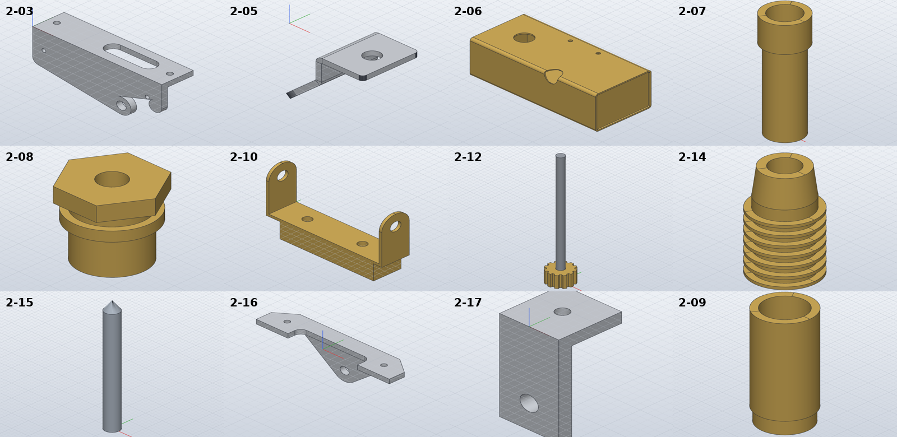
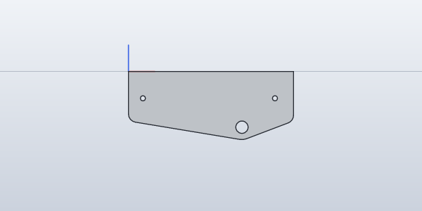

# Model the chassis front end, steering brackets and fuel tank

*Activity 08 · 2026-10-29*

**Fourteen group 2 parts from sheet 04 (2-01 and 2-03 to 2-17) were modelled and checked, including a sheet-metal bracket and a fuel tank with its fittings. A wrongly placed flank on 2-03 passed the volume check but was caught in a render.**

## Aim

After the motor group was complete and logged, the owner said "go on". The next drawing number group is 2: the chassis front end, the steering brackets and the fuel tank with its fittings. Most of it is on sheet 04, the rest on sheet 05. This activity covers the sheet 04 parts.

Done meant the same check as before. Each part's hand volume had to agree with SolidCraft's measured volume and with the volume of an exported STL mesh, and its render had to match the drawing's views. 2-11, the tank hanger, was left out: its view gives neither its length nor where its rods sit.

## Tools

| Tool | Version | Used for |
| --- | --- | --- |
| `pdftotext -layout`, `pdftotext -bbox` | poppler | Part names from the parts list; positions of material labels |
| `crop4.py`, `circles.py`, segment scripts | session scripts | Crops of sheet 04 at 400 dpi; circle fits and line lists in mm |
| SolidCraft `solvecraft-cli` | repo build | Building, `sheet.flange` / `sheet.fold`, snapshots in front, bottom and back views |
| Python | 3.13 | `gen_parts.py` |

## Process

### 1. Listing the group

*The group 2 parts from the parts list on sheet 02*

```bash
pdftotext -layout $U/478a0380-lanz-a3-sheet-02.pdf - | grep -oE "[0-9]+ LANZ-2-[0-9]+[A-Z]?-[A-Z0-9 .-]+"
```

Output (start): `1 LANZ-2-01-CHASSIS FRONT END`, `1 LANZ-2-03-LH-STEERING AND FUEL TANK BRACKET`, … `1 LANZ-2-11-FUEL TANK HANGER BRACKET`, …

There is no 2-02.

### 2. The chassis front end and its material

2-01 is a 254 x 88 x 6 plate. It has a window, countersunk holes and a recess shown in detail "A". Circle fits gave the hole sizes, and the window's corner radius came from its polyline:

```text
[447.73, 613.56, 447.33, 615.06] [447.33, 615.06, 447.23, 616.46]   (window corner, at 1:1.5: R4)
```

No material is printed next to 2-01. `pdftotext -bbox` listed every label on the sheet with its position, and none sits near the part. Its light shading matches the aluminium parts on the sheet, so aluminium was assumed and noted in the README.

Output: `2-01: OK 1/1 bodies, hand volume 91742.8 mm³, … SolidCraft 91743.5 (+0.00 %), mass 247.7 g, box 254.00 x 88.00 x 6.00`

### 3. A bent bracket in sheet metal

2-05, the steering floor bracket, is 1.5 aluminium bent into a Z. It was built like 1-43 in activity 06: a base flange from the flat pattern, then folds.

Output: `2-05: OK 1/1 bodies, hand volume 701.7 mm³, STL mesh 701.7 (-0.00 %), SolidCraft 701.7 (-0.00 %)`

### 4. The tank and its fittings

2-06 is a 90 x 40 x 30 brass box. Its R2 tube corners were read from section F-F and its ports from circle fits (Ø4.8, Ø3.5, Ø11). The spout (2-07), spout cover (2-08), wick pipe (2-09), wick holder with seven cooling fins (2-14) and the wick (2-15) are turned parts. 2-12 is a 12-tooth brass gear pressed onto a Ø4 steel shaft, modelled as two bodies. The wick has no matching material in SolidCraft's list, so it uses the default density.

```text
2-06: OK   1/1 bodies, hand volume 13925.3 mm³, … SolidCraft 13925.4 (+0.00 %), mass 118.4 g
2-14: OK   1/1 bodies, hand volume 2909.6 mm³, …
2-12: OK   2/2 bodies, hand volume 1790.7 mm³, … SolidCraft 1790.6 (-0.0…
```

2-10's ear rounding was first cut with a polyline of 5° steps. It passed, but a true arc is the honest model, so the rounding was redone as two `sketch.arc` loops cut through all. It still checks:

Output: `2-10: OK 1/1 bodies, hand volume 3000.3 mm³, … SolidCraft 3000.3 (+0.00 %)`

### 5. A flank on the wrong side

All the parts passed their checks, and a contact sheet of the renders came next.



*Figure 1 — The first renders of 2-03 to 2-17*

> Look at 2-03, top left: beside the R6 nose round the Ø6 hole there is a small hook. The drawing has none. Its flank should run tangent into the nose on both sides. The rest match their views: 2-10's two ears, 2-12's gear on its long shaft and 2-14's seven fins.

The bracket's leg outline used a helper, `angle_bracket`, that offsets each flank line outward by its normal. The normal flipped with the side of the part, so one flank landed on the wrong side of the nose. The volume check could not catch this, because the wrong outline was what the hand calculation used too. The fix was one line:

*The flank normal, before and after*

```python
n = (u[1], -u[0]) if side < 0 else (-u[1], u[0])      # outward normal (below the line)
n = (u[1], -u[0])                                       # outward normal (below the line)
```

Output: `2-03: OK 1/1 bodies, hand volume 11360.1 mm³, … SolidCraft 11360.1 (+0.00 %)` (it was 10642.8 before)



*Figure 2 — 2-03 seen square-on after the fix*

> The leg now has R4 corners at the top and flanks running tangent into the round at the Ø6 hole on both sides, as drawn. The two small holes are the M4 tapping holes. 2-04 is its mirror image and got the same fix.

2-16's web was then checked from the back and top in the same way, and it matched.

## Results

Pushed as `793175d`: 2-01, 2-03 to 2-10, 2-12 and 2-14 to 2-17, which brought the series to 69 parts.

- All within 0.02 % of the hand volume. The STL check agrees within 0.2 % where the mesh is closed.
- 2-05 is real sheet metal that SolidCraft can unfold.
- One modelling error (2-03/2-04) was found by looking at the render, not by the numbers.

### Limits and what was left

- 2-11 (tank hanger) is not modelled: its length and rod positions are not drawn.
- 2-01's material is assumed. 2-12's 12 teeth were counted and have straight flanks.
- 2-13 and 2-18 onward on sheet 04 were left for the next activity.

---

*Written retrospectively from the session transcript*
