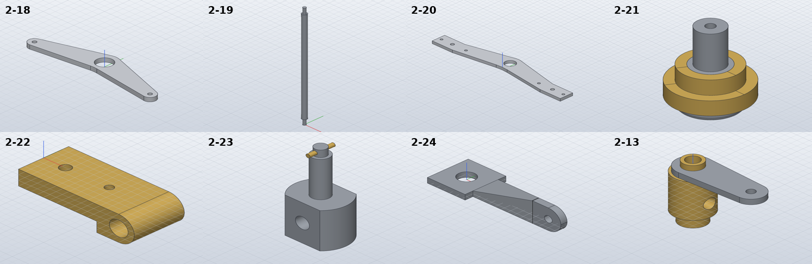

# Model the axle yoke parts, pivot axle and handle collar

*Activity 09 · 2026-10-29*

**The last eight parts on sheet 04 (2-13 and 2-18 to 2-24) were modelled from the drawing and its vector lines. One needed a 90° twisted neck, built as a loft that starts inside the plate so the boolean join stays exact.**

## Aim

The owner said "go on" again. Sheet 04 still held the axle yoke group: two arms, a tie rod, a flanged bearing, the wheel hinge bracket, the pivot axle with its pin and a connector bracket whose arm twists through 90°. The fuel tank handle collar (2-13) was left over from activity 08.

Done meant every part checked as before. Undimensioned sizes were to be measured from the PDF's vector lines, not guessed from pixels.

## Tools

| Tool | Version | Used for |
| --- | --- | --- |
| `pdftoppm -r 1200` | poppler | Zoomed renders of small sections |
| `vlines.py`, `s04_segs.json` | session scripts | Line lists of 2-21's section in points |
| SolidCraft `solvecraft-cli` | repo build | `solid.loft`, `solid.fillet`, `solid.revolve`, step-by-step evaluation |
| Python | 3.13 | `gen_parts.py`: new `tangent_from`, `outer_tangent`, `valley_fillet`, `cross_hole` helpers |

## Process

### 1. Arms built from tangent lines

2-18 and 2-20 are 4 mm aluminium arms. Their outlines are lines tangent to circles of different radii, with concave rounds where the lower edges meet. Three small helpers compute this: the tangent from a point to a circle, the outer tangent of two circles, and a concave fillet in a symmetric valley. As a check, 2-18's upper edges, tangent from the R4.5 ends to the R9.5 boss, should cross 10 above the Ø12 centre, which is the drawing's dimension. The computed crossing was 9.98.

```text
2-18: OK   1/1 bodies, hand volume 4961.7 mm³, … SolidCraft 4961.7 (+0.00 %), mass 13.4 g, box 103.00 x 24.00 x 4.00
2-20: OK   1/1 bodies, hand volume 11099.3 mm³, STL mesh 11103.9 (+0.04 %), SolidCraft 11099.4 (+0.00 %)
```

While the code was being written, 2-20's tangent was first put on the wrong side of the R11 round. It was changed (`left=False` to `left=True`) before the first build.

### 2. Reading the bearing from its lines

2-21 is drawn as a small half section. The crop showed two parts, a brass bush and a steel pin, but not their exact lengths. The line list gave them at 1.8898 pt per mm:

```text
x = 935.55 (head end), 941.14, 948.74, 956.44, 975.43 (thread end)
y = 581.47 / 604.16 (Ø12), 585.27 / 600.37 (Ø8), 587.17 / 598.57 (M6), 590.97 / 594.77 (Ø2)
```

So: a Ø12 x 3 head, a Ø16 x 4 flange, the bush 8.1 long overall with a Ø12 x 4.1 spigot, an M6 x 10 end, and a Ø2 hole right through the pin. The 4.1 spigot matches 2-20's 4 mm thickness, so the bush is pressed into the arm's Ø12 hole. The head's R1 edge round is a `solid.fillet`, and its volume uses the spandrel's centroid:

```python
k = (10 - 3 * math.pi) / (12 - 3 * math.pi)                # spandrel centroid from the corner, x r
v -= 2 * math.pi * (6 - k) * (1 - math.pi / 4)
```

Output: `2-21: OK 2/2 bodies, hand volume 1815.9 mm³, STL mesh 1815.2 (-0.04 %), SolidCraft 1815.8 (-0.00 %)`

### 3. The twisted neck

2-24 is a 2 mm plate with a Ø5 hole. An 8 wide neck leaves the plate and twists through 90° into a tab 8 high and 2 thick. SolidCraft has `solid.loft`, so the twist became a loft from the plate's 8 x 2 section at X = 6 to the tab's 2 x 8 section at X = 22. Its first join touched the plate's end face:

```text
2-24: FAIL … SolidCraft 745.4 (+0.03 %)
   Twist: Boolean retry: … temporary coincident-face separation up to 8.326284e-1 mm per face
```

Building the loft first, then joining the plate, gave no warning but a wrong volume. Stepping through the build showed where:

```text
st12.json [352.0]        loft alone: exact (16 x (16 + 36/6))
st16.json [664.983]      + plate 312: 0.98 mm³ too much
```

The loft alone had six planar faces, so it could be extended. It now starts 1 mm inside the plate, with its section extrapolated along the same planes. The two solids cross instead of touching.


*Figure 1 — The loft (blue) between the plate and the tab, top and side view*

> The dashed line is the plate's end face at X = 6. The loft begins 1 mm to the left of it, inside the plate, where its section is 8.375 x 1.625. Those are the same four planes carried back. Below X = 6 the loft lies entirely inside the plate, so the union adds only the part to the right, which the hand formula already counts.

Output: `2-24: OK 1/1 bodies, hand volume 745.2 mm³, STL mesh 745.2 (+0.01 %), SolidCraft 745.2 (+0.00 %)`

### 4. Pivot axle and collar

2-23 is a Ø18 block with flats 13 apart, a Ø6 axle and a Ø4 top drilled Ø1.5 for a brass pin. The axle starts 1 inside the block so the two solids overlap rather than touch. The volume a cross hole removes from a round bar went into a new helper, `cross_hole`, used for 2-23's pin hole and 2-13's collar.

```text
2-22: OK   1/1 bodies, hand volume 3615.2 mm³, …
2-23: OK   2/2 bodies, hand volume 3630.4 mm³, STL mesh 3628.6 (-0.05 %), SolidCraft 3630.3 (-0.00 %)
2-13: OK   2/2 bodies, hand volume 1797.1 mm³, …
```



*Figure 2 — The eight parts as built*

> 2-21 shows the brass flanged bush on the steel pin, with only the M6 end showing above. 2-23's brass pin crosses the Ø4 top. 2-24's neck narrows in plan and widens in height on its way to the round tab.

## Results

Pushed as `7b16b70`: 2-13 and 2-18 to 2-24. Sheet 04's group 2 parts are complete except 2-11.

- All within 0.03 %. Where the STL mesh is closed it agrees within 0.1 %, apart from 2-19's thin Ø3 ends (1.1 %).
- A third way SolidCraft's joins go wrong was found: joining a plate to a loft's touching end face added 0.98 mm³ with no warning.

### Limits and what was left

- 2-20's R11 is taken as centred on the Ø12 hole.
- 2-23's pin end form ("2PF") is not modelled.
- 2-24's twist has flat faces where the drawing curves, and steel is assumed.

---

*Written retrospectively from the session transcript*
