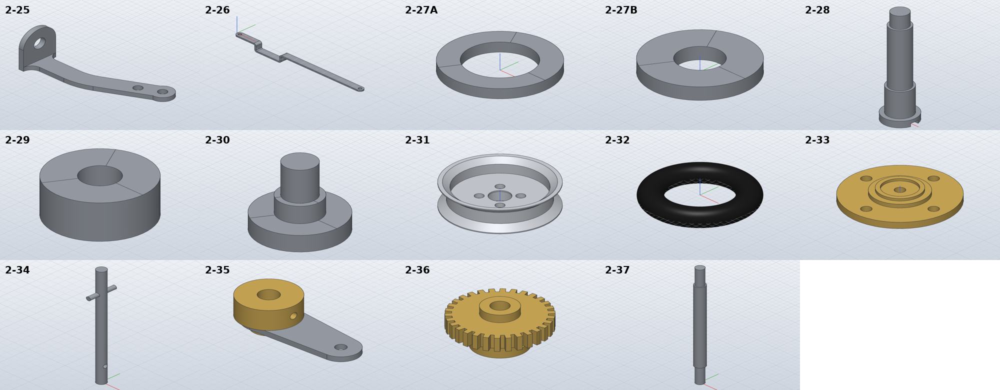

# Model the front wheels, steering arm and lay shaft parts

*Activity 10 · 2026-10-29*

**Fourteen parts from sheet 05 (2-25 to 2-37) were modelled, the rim and hub cap profiles taken line by line from their sections. A counterbore pattern placed on a revolved part's seam needed a separation retry and came out 46 mm³ short, until the pattern was turned 45°.**

## Aim

With sheet 04 done, work moved to sheet 05, which holds 2-25 to 2-49. This activity took its left half. That covers the wheel pivot steering arm and connecting rod, spacers, the wheel axle, bearing and screw, the front wheel (rim, tyre, hub cap) and the steering lay shaft with its crank, gear and tie rod.

Done meant the usual check. The two sections, the rim's A-A and the hub cap's B-B, were to be read from the PDF's vector lines, because only some of their sizes are dimensioned.

## Tools

| Tool | Version | Used for |
| --- | --- | --- |
| `pdftoppm`, `pdftocairo -svg` | poppler | Sheet 05 at 400 dpi; vector paths into `s05_segs.json` (36,709 segments) and `s05_circ.json` (395 fitted circles) |
| Line-listing snippets | session | Outline points of the bend, the rim and the hub cap in points |
| SolidCraft `solvecraft-cli` | repo build | Building; `appearance.assign` for the tyre; step-by-step evaluation |
| Python | 3.13 | `gen_parts.py` |

## Process

### 1. The steering arm's bend from its polylines

2-25 is a steel upright with a flat arm that bends 26° on R16.5. The drawing gives the radius and the angle but not where the bend starts. The arm's two edges are polylines. Both bends start at x = 60.78 pt, and they end where straight lines begin:

```text
top edge:    (60.78, 55.67) … (74.57, 52.37), then the line to (107.36, 36.28)
bottom edge: (60.78, 68.87) … (80.47, 64.27), then the line to (113.26, 48.07)
```

A 26° turn over Δx = 13.79 pt gives R = 13.79 / sin 26° = 31.46 pt = 16.65 mm on the inside, and 23.77 mm on the outside. That is R16.5 plus the 7 width, so the two edges are concentric. The bend therefore starts 16 from the upright's back. The two hole centres fitted 8.0 apart along a 26.3° line, which confirms the angle.

Output: `2-25: OK 1/1 bodies, hand volume 1046.2 mm³, … SolidCraft 1046.2 (+0.00 %), box 47.98 x 22.40 x 17.00`

### 2. The cranked connecting rod

2-26 is a strip 172 long that drops 10 between 28 and 64 from one end. The side view is broken, so its scale was taken from the 28 and 36 dimensions (10.46 px per mm), not the 164 between the holes. It was extruded from a side profile with R1 inside and R3 outside bends. The end rounds were first sketched facing +Z, which would have cut empty space above the part. This was caught in review and the sketch flipped to face down before the first build.

Output: `2-26: OK 1/1 bodies, hand volume 2939.3 mm³, STL mesh 2938.3 (-0.04 %), SolidCraft 2939.3 (-0.00 %)`

### 3. The rim and the hub cap from their sections

The rim section's lines, at 1.8898 pt per mm about the axis y = 112.35, gave every step: Ø72 and Ø66.5 faces, a 45° groove 10 wide on a Ø62 floor, a Ø58 bore 4.3 deep, a cone from Ø50 to a Ø32 hub face 1 proud, and a web 10 thick with a Ø16 counterbore 9 deep and Ø14 through. M3 holes on a Ø24 PCD are counterbored Ø6 x 4 from the other side. The hub cap's B-B section was read the same way at 1:1. A 1600 dpi render settled its one doubt: the Ø10 inside the Ø12.5 lip is a recess, because the line across it is the far edge of the ring, seen beyond the cut.


*Figure 1 — The rim's (r, z) profile, and its hole pattern seen along the axis*

> The grey polygon is the profile that gets revolved. The blue rectangles at r = 12 are an M3 hole and the Ø6 counterbore above it. On the right, the dashed circles are the holes as drawn at 0°, 90°, 180° and 270°. The one at 0° sits on the line where the revolve's profile was sketched (the seam). The solid circles are the pattern turned 45°, which is what fixed the build.

### 4. A cut on the seam

The rim failed with a retry warning and too much volume:

```text
2-31: FAIL 1/1 bodies, hand volume 27922.2 mm³, … SolidCraft 27967.8 (+0.16 %)
   Ø6 counterbores: Boolean retry: temporary coincident-face separation up to 1.958554e0 mm per face
```

Starting both cuts 1 mm clear of the faces changed nothing. Stepping through the build showed the M3 cut was right and the counterbore cut short:

```text
st03.json [28491.661]   revolve (28492.37 by Pappus)
st10.json [28295.9]     M3 holes: 195.8 removed
st17.json [27967.844]   counterbores: 328.1 removed, 373.9 expected  ['Boolean retry: … separation …']
```

Cutting the counterbores first did not help either. Nothing in the profile lies at r = 9 or 15, or at z = 6. What does lie there is the revolve's seam, the XZ half plane, which ran through the counterbore at 0°. A round part does not care how its hole pattern is turned, so the pattern was moved to 45°:

Output: `2-31: OK 1/1 bodies, hand volume 27922.2 mm³, STL mesh 27922.0 (-0.00 %), SolidCraft 27922.1 (-0.00 %)`

### 5. Gear, tyre and the rest

2-36's 30 teeth were cut as gaps from a Ø32 blank. The gaps are 1.7 wide at the tip and 1.1 at the root, from the drawing's detail, and each gap's area includes the segment between its chord and the tip circle. SolidCraft has no rubber material, so the tyre uses the default density (1.29) with the built-in "Rubber - Black" appearance.

```text
2-32: OK   1/1 bodies, hand volume 122651.5 mm³, STL mesh 122502.0 (-0.12 %), SolidCraft 122633.5 (-0.01 %)
2-36: OK   1/1 bodies, hand volume 6227.0 mm³, … SolidCraft 6226.8 (-0.00 %)
```



*Figure 2 — The fourteen parts as built*

> 2-25's arm bends away from the upright. 2-26 drops in its crank. 2-31's groove, bore and four counterbores are visible from the hub side. 2-33's lip sits inside its Ø16 hub, and 2-35's brass collar carries its set-screw hole.

## Results

Pushed as `ed67bb1`: 2-25 to 2-37, including 2-27A and 2-27B.

- All within 0.02 %. Closed meshes agree within 0.3 %.
- A fourth SolidCraft problem was found and documented: a cut across a revolved solid's seam needs a separation retry and comes out short.

### Limits and what was left

- 2-29 is a bought-in bearing, modelled as its Ø16 / Ø6 x 8 envelope.
- 2-30's slot and 2-36's R5 worm throat are not modelled, and 2-36's tooth width (6) is measured.
- 2-35's bore is taken as Ø6, from the lay shaft it fits.

---

*Written retrospectively from the session transcript*
