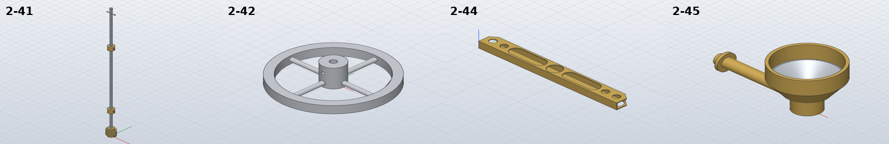
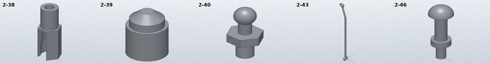

# Model the tie rod ends, steering column, steering wheel and lights

*Activity 11 · 2026-10-29*

**Nine parts from sheet 05 (2-38 to 2-46) were modelled. On the way, four more SolidCraft limits were found and worked around: an inside-out revolve, a tangential wire join, a contact-work limit on coils and a hole tangent to a tube wall.**

## Aim

These are the remaining small parts on sheet 05: the tie rod end with its plug and ball joint, the accelerator link (a wire with two eyes), the steering column with its worm and pinned collars, the steering wheel, the light beam (a thin brass tube), the lampstand and the pulling hook.

Done meant the usual check. The parts drawn at 1:1 or 1.5:1 (2-38, 2-45) were to be read from their lines, because several of their sizes are not dimensioned.

## Tools

| Tool | Version | Used for |
| --- | --- | --- |
| `pdftoppm -r 900`, line lists | poppler / session | 2-38's section C-C, 2-44's plan and 2-45's half section in points |
| SolidCraft `solvecraft-cli` | repo build | `solid.pipe`, `solid.coil`, `solid.sphere`, `solid.cylinder`, `solid.revolve` |
| Python | 3.13 | `gen_parts.py`; `removed_by_cylinder` for the wire's overlaps with its eyes |

## Process

### 1. The tie rod end's socket

2-38 is a 7 AF hex with a ball socket and a slot for the ball's neck. Its section, at 4.252 pt per mm, showed a Ø6 bore 7 deep, Ø5 on to 12, a cone to Ø4 at 13.5, M4 beyond, and a 4 wide slot from the flat into the bore. The slot's walls meet the Ø6 bore at y = −2.236, which matches the line drawn at r −2.22. Its hand volume integrates the section area along z, using Simpson's rule through the cone.

Output: `2-38: OK 1/1 bodies, hand volume 444.8 mm³, … SolidCraft 444.8 (-0.00 %)`

### 2. A ball that revolved inside out

2-40's first build joined a revolved neck-and-ball onto a revolved stem and failed. Revolving everything in one profile and joining the planar hex over it still failed, with an "implausible result volume". The revolve on its own showed why:

```text
{'command': 'sketch.arc.center_point', 'params': {'center': [0, 8], 'start': [1.5, 6.0], 'end': [0, 10.5]}}
[(-61.371290044755945, {'cylinder': 2, 'plane': 2, 'sphere': 1})]
```

The arc is correct: radius 2.5, counter-clockwise, 143° from the neck over the equator to the pole. The solid still came out inside out, as the two-arc pipe of 1-34 did in activity 07. Split into two arcs at the equator, it is right:


*Figure 1 — The same profile with one arc and with two*

> The left profile's single arc crosses the dashed equator (Z = 8) and revolves into a −61.4 mm³ solid. The right profile ends an arc on the equator (the dot) and starts a second one there. 2-46's head arc starts on its equator and never had the problem.

Output: `2-40: OK 1/1 bodies, hand volume 257.3 mm³, STL mesh 257.1 (-0.07 %), SolidCraft 257.3 (-0.01 %)`

### 3. A wire eye that touched tangentially

2-43 is a Ø2 wire with eyes at right angles to each other. The legs are a `solid.pipe` (line, R3 arc, line). The eyes are tori revolved about a sketch axis. A leg ended on an eye's centre line has the same diameter as the eye's tube, so its sides touch the tube tangentially, and the join failed. Stopping each leg 0.3 short of the centre line fixed it. The overlap left in the volume is measured numerically:

```python
g0 = RE + 0.3
v -= removed_by_cylinder(in_lower, (0, 0, g0), (0, 0, 1), D, 1.5)
```

Output: `2-43: OK 1/1 bodies, hand volume 349.2 mm³, … SolidCraft 349.1 (-0.03 %)`

### 4. The worm's thread and a kernel limit

2-41's worm thread is a `solid.coil` with a square 2.2 section and a 3.96 lead (6° on Ø12). On its own it measured 538.18 mm³, against 538.27 for the section swept round its mean radius. Joining it to the core failed every time:

```text
2-41: FAIL error: step 17 (solid.coil): lumps: contact work exceeds the limit
1.5: [1466.05]   2: [1548.87]   2.5: error: … contact work exceeds the limit
```

The kernel caps the product of the two solids' triangle counts. Two 1.5-turn coils joined end to end, the second starting at 180°, gave 1715.03 against 1715.00 by hand. That worked on a plain cylinder core, not on a bored one, so the core is bored last. The build then took over ten minutes. When checked, the snapshot render alone had used over four minutes of CPU.

Output: `2-41: OK 4/4 bodies, hand volume 5674.1 mm³, … SolidCraft 5671.9 (-0.04 %), box 14.00 x 14.00 x 254.00`

### 5. A hole tangent to the tube

2-44 is a 9 x 5 x 0.5 brass tube. Its lines gave the 37° corner cuts from 6.3 across the end, the holes, and the Ø7 holes in the bottom wall, drawn dashed. The top-hole cut failed with "faces that touch". The cause was the Ø8 hole: the tube is exactly 8 wide inside, so the hole is tangent to both side walls. A first guess, that two coaxial Ø4 cuts caused it, was wrong; the comment written on that guess was corrected. Ø7.98 cuts cleanly.

Output: `2-44: OK 1/1 bodies, hand volume 863.6 mm³, STL mesh 864.2 (+0.06 %), SolidCraft 863.7 (+0.00 %)`



*Figure 2 — Steering column, steering wheel, light beam and lampstand*

> 2-41's worm sits at the bottom of the 254 column, with two pinned collars above it. 2-42's four Ø3 spokes reach from the hub into the rim. 2-44 shows its slots, the Ø8 and the cut corners. 2-45 is four bodies: the brass housing, the stainless reflector seen through the mouth, the stem and the washer.



*Figure 3 — Tie rod end, plug, ball joint, accelerator link and pulling hook*

> 2-38's slot opens into the bore on one flat. 2-43's two eyes face different ways, and its kink is the R3 bend.

## Results

Pushed in two commits, `660d9a1` (2-38, 2-39, 2-40, 2-43, 2-46) and `c871bb7` (2-41, 2-42, 2-44, 2-45).

- All within 0.04 % (2-43 within its 1 % thin-wire allowance).
- Four new SolidCraft limits were recorded in the README, each with its workaround.

### Limits and what was left

- 2-41's worm has a square thread form instead of the drawn trapezoid.
- 2-43's eye size is taken as the centre line, and its eyes are closed rings.
- 2-44's Ø8 is 7.98.
- 2-45's cone wall and reflector are read off the drawing, and so are not all dimensioned.

---

*Written retrospectively from the session transcript*
