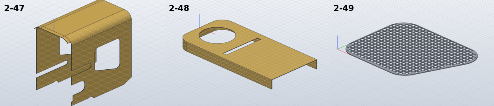

# Model the motor covers

*Activity 12 · 2026-10-29*

**The three 0.5 mm motor covers (2-47 to 2-49) were modelled after plain extrude cuts on the large thin brass sheets went wrong without a warning. The tray was hollowed with `solid.shell`, and the U-shaped side cover was built with the sheet-metal flange and folds.**

## Aim

The last group 2 parts on sheet 05 are sheet work. 2-47 is a 302.2 x 99 flat blank with two 90° bends on R11.5, windows, slots and an arch. 2-48 is a 123.5 x 59 tray with a 14 deep skirt, a Ø34 hole and a slot. 2-49 is a 69.5 / 49.5 x 52 gauze with R11 corners.

Done meant the usual check. The owner also asked for a status report halfway through, which was given before this work finished.

## Tools

| Tool | Version | Used for |
| --- | --- | --- |
| Line lists, `pdftoppm` crops | session / poppler | The gauze's pitch (2.5) and opening (2.0); 2-48's slot length |
| SolidCraft `solvecraft-cli` | repo build | `solid.shell`, `sheet.manage_rules`, `sheet.flange`, `sheet.fold`, STL export |
| Python | 3.13 | `fillet_polygon` and `in_fillet_polygon` helpers; STL face-area probe |

## Process

### 1. First builds: both covers wrong, no error

2-48 was an extrude of its outline 14 down with the inside cut out to leave a 0.5 top. 2-47 was its plan section, a U with R11.5 and R12 arcs, extruded up from the tab's edge. The tab was then trimmed off below the bottom edge and the cut-outs cut through the sides.

```text
2-47: FAIL … hand volume 12294.3 mm³, … SolidCraft 11809.3 (-3.95 %)
   Left side cut-outs: Boolean retry: shifted operands 9.908951e-1 mm (result shifted back), tolerance 3.490891e-1 mm; …
2-48: FAIL … hand volume 5042.3 mm³, … SolidCraft 2061.5 (-59.12 %)
```

### 2. Finding what the cuts did

The 2-48 tray lost exactly its top: 2061.5 is the skirts alone. Varying the pocket depth showed a threshold:

```text
14.0  [9133.6]  9132.90 expected
14.3  [7012.0]  7011.24 expected
14.45 [2061.5]  5950.41 expected
```

A cut that leaves 0.7 or more is right. One that leaves 0.55 takes the 0.5 wall with it.

On 2-47, the tab trim removed 212.5 mm³ too much at every depth tried. An STL export of the result, scanned for faces that point along Y, showed where the extra went:

```text
(-5.0, False) 93.659 [-29.32, 29.32, -126.82, 0.5]
(-1.25, False) 57.411 [28.82, 29.32, -126.82, -12.0]     <- the side's bottom edge, asked for at -3.0
```

A cut tool that was moved, shortened and replaced with a plain rectangle always went 1 to 1.75 too deep. Asked for zero depth, it removed 1 mm. A window cut through the middle of a side was exact (13947.7 against 13947.9). On a 0.5 sheet this size, the boolean's tolerance (about 0.35 mm) and its 1 mm nudge are as large as the wall. Cuts whose faces end near a sheet face or edge go wrong; cuts through the middle do not.

### 3. The tray with a shell

`solid.shell` removes the chosen faces and leaves walls of the given thickness:

```python
s.cmd("solid.shell", faces=[[L / 2, 0, -D], [L, 0, -D / 2]], thickness=T, direction="inside", name="Shell")
```

Output (test): `[5597.54]  want 5597.488905574544`, then `2-48: OK 1/1 bodies, hand volume 5042.3 mm³, … SolidCraft 5042.4 (+0.00 %)`

### 4. The side cover as sheet metal

Joining the tab onto a clean U failed ("a neighbouring edge is not straight"). Cutting the edge features with tools reaching 10 past the sheet still went wrong (2101 removed, 489.5 expected). The sheet-metal tools avoid both: every edge feature goes into one flat outline for `sheet.flange`, the windows are cut in the flat (an interior cut, which works), and two folds bend it.


*Figure 1 — The flat blank, its two bend zones and the tab*

> The blue bands are the bend zones, 18.46 wide (R11.5, K-factor 0.5) about the dashed bend lines 53.1 apart. The circled points are the corners of the 59.5 x 5 tab under the middle. They fall inside the zones, and `sheet.fold` refuses a zone that contains a corner (activity 06). So the blank is folded without the tab, and the tab is a second solid of the same brass, shaped to the U.

*The folds, both holding the middle panel fixed*

```python
for x in (BL / 2, -BL / 2):
    s.cmd("sheet.fold", points=[[x, -2, T], [x, H + 2, T]], angle=90, position="centerline", flip=True,
          fixed=[0, H / 2, T], body=f"{n} cover")
```

Output: `2-47: OK 2/2 bodies, hand volume 12294.3 mm³, STL mesh 12291.9 (-0.02 %), SolidCraft 12294.1 (-0.00 %)`

With K = 0.5, sheet metal keeps its volume, so the hand value is the flat area times 0.5, plus the tab.

### 5. The gauze

The gauze's grid lines are 3.6 pt apart at 1:2: a 2.5 pitch, 2.0 openings and 0.5 wire. It became a 0.5 sheet with square holes, keeping only the holes that lie wholly inside the rounded outline. A new helper, `in_fillet_polygon`, tests that. All the holes go in one sketch and one cut through the middle of the sheet.

Output: `2-49: OK 1/1 bodies, hand volume 596.4 mm³, STL mesh 596.2 (-0.04 %), SolidCraft 596.4 (-0.01 %)`



*Figure 2 — The three covers*

> 2-47 is folded into its U with the windows, slots and arch on the sides. 2-48's skirt runs round the rounded end and along both sides, open at the square end. 2-49's square openings stop short of the edge, where the drawing shows cut-off ones.

## Results

Pushed as `4e2d845`. With it, group 2 is complete except 2-11: 103 parts in `parts/summary.json`.

- All three are within 0.02 %.
- 2-47 is real sheet metal, so SolidCraft can unfold it.
- The README records the thin-sheet problem and both workarounds.

### Limits and what was left

- 2-47's inside comes to 57.6 (K 0.5), where the end view says 58. Its tab is a separate solid.
- 2-48's unexplained line 4 short of its open end is ignored.
- 2-49's partial openings are left closed, and the bulge in its 3D view is not modelled.

---

*Written retrospectively from the session transcript*
