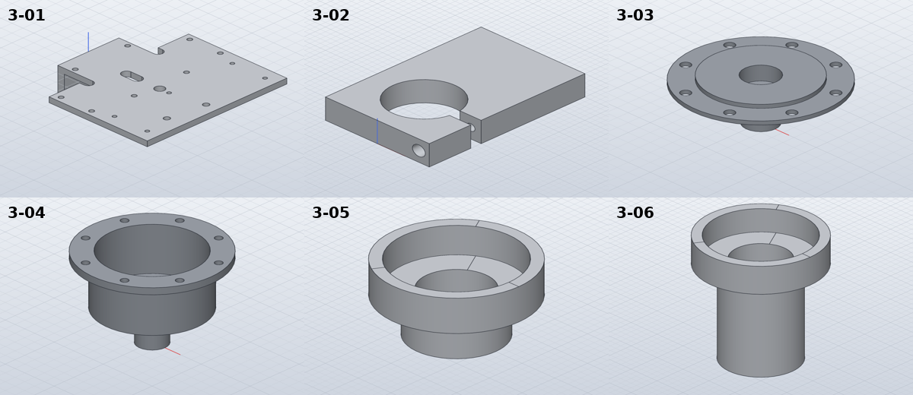
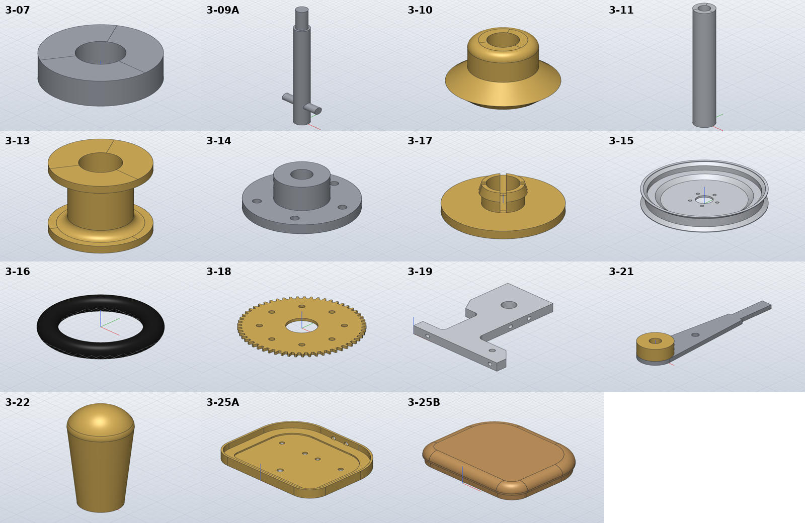

# Model the rear chassis, housings, rear wheel and seat

*Activity 13 · 2026-10-29*

**Twenty-seven group 3 parts from sheets 05 and 06 (3-01 to 3-26A) were modelled, most section profiles read from the drawing's vector lines. A tapped hole ending in the plane of a distant face came out 2.5 mm too deep after a SolidCraft separation retry.**

## Aim

After group 2 the owner said "go on". Group 3 is the rear of the tractor, 51 parts spread over sheets 05, 06, 07, 09 and 10. This activity covers the parts drawn on sheets 05 and 06: the chassis rear end and axle brackets, the differential and bearing housings, bearings and axles, the rear wheel (rim, tyre, hub cap, drive gear), the console side frame, the accelerator lever and knob, and the seat.

Done meant the usual check: hand volume against SolidCraft's volume and an STL mesh volume, plus a look at the renders.

## Tools

| Tool | Version | Used for |
| --- | --- | --- |
| `pdftotext`, `pdftocairo -svg` | poppler | The group 3 parts list and which sheets carry each part; sheet 06's vectors (29,788 segments, 414 circles) |
| Line-listing snippets, `pdftoppm -r 1000` | session / poppler | Section steps in points; a 1000 dpi render of 3-17 |
| SolidCraft `solvecraft-cli` | repo build | Building; step-by-step evaluation of partial scripts |
| Python | 3.13 | `gen_parts.py`: new `pcd_holes`, `revolved_loop`, `spandrel_ring`, `tray_outline` helpers |

## Process

### 1. Where the parts are

*Each sheet's part numbers, from the PDFs' text*

```bash
for f in $U/*.pdf; do n=$(pdftotext "$f" - | grep -oE "\b3-[0-9]{2}[A-Z]?\b" | sort -u | tr '\n' ' '); echo "$(basename $f): $n"; done
```

Output (part): `822f6658-lanz-a3-sheet-05.pdf: 3-01 3-02 3-03 3-04 3-05 3-06`, `e4ed1a75-lanz-a3-sheet-06.pdf: 3-03 3-07 … 3-26A`

### 2. Sections from their lines

The differential housings 3-03 and 3-04 are half sections. Listing the axis-parallel lines in each section's box gave every step. For example, 3-05's vertical lines lie at x = 695.64 … 731.82 pt, which at 1:2 are the Ø24 tube 13.5 long and the Ø38 × 12 flange, with Ø20, Ø18 and Ø32 bores. The flange holes of 3-03 and 3-04 are turned 22.5° from the drawing, off the revolve's seam, because of the seam problem found in activity 10.

The first build of the two housings failed on the hand formula, not the model:

```text
3-03: FAIL … hand volume 10285.6 mm³, … SolidCraft 10134.7 (-1.47 %)
```

The hole term divided the hole area by the flange thickness instead of multiplying by it. Fixed, both came within 0.00 %.



*Figure 1 — The chassis rear end, axle bracket and the four housings*

> 3-01's flange hangs below the narrow end with its three Ø6 holes; 3-02's split clamp shows the Ø24 bore and the 4 wide slot. 3-04's 8 flange holes match 3-03's on the Ø52 PCD.

### 3. The rear wheel

The rim 3-15 is a pressed profile about 2 thick with a 3 thick web, read from section B-B. The tyre 3-16 is a Ø33.8 torus on the rim's Ø132 floor, using the default density and the black rubber appearance, as 2-32. The drive gear 3-18 has 57 straight-flanked teeth (Ø78.8 / Ø73.5) and takes 3-03's hole pattern. The hub cap 3-17 needed a 1000 dpi render to see its split snap spigot: Ø7 with a barb to Ø8 and a 1 wide cross slot. The slot's volume was integrated strip by strip along the spigot.

```text
3-15: OK   1/1 bodies, hand volume 66225.7 mm³, … SolidCraft 66225.2 (-0.00 %), mass 178.8 g
3-16: OK   1/1 bodies, hand volume 467366.6 mm³, STL mesh 466510.4 (-0.18 %), SolidCraft 467298.4 (-0.01 %)
3-17: OK   1/1 bodies, hand volume 541.5 mm³, … SolidCraft 541.4 (-0.01 %)
```

### 4. A hole cut too deep, far from anything

The console side frame 3-19 is an 8 thick aluminium L with a notch in its back edge and six M4 holes. Its build passed the volume check but carried a retry warning:

```text
3-19: FAIL … SolidCraft 23645.4 (+0.00 %)
   M4 underside: Boolean retry: temporary coincident-face separation up to 2.497071e0 mm per face
```

Stepping through the build showed the M4 at X = 66 removing 89.8 mm³ instead of 68.4: it was 10.5 deep, not 8. Its end face lay in the plane Y = 8, the floor of the notch, although the two faces are 48 mm apart.


*Figure 2 — The M4 at X = 66 and the notch floor plane*

> The dashed line is the notch floor's plane. The grey hole is the 8 deep one asked for, and the blue one is what the retry left. Ending the hole at Y = 9 instead removes the shared plane, and the cut is exact.

Once the hole ended at Y = 9, the model came out 0.09 % above the hand value. A second M4 in the front edge, at 61 up, was meant to run into the Ø10 bore but stopped 2.5 short of it. Drilled through to the bore, the part checked exactly:

Output: `3-19: OK 1/1 bodies, hand volume 23636.0 mm³, STL mesh 23643.3 (+0.03 %), SolidCraft 23636.2 (+0.00 %)`

### 5. Seat, knob and towbar bracket

The seat base 3-25A is a tray of a 1 plate and a 6 × 5 × 1 angle, built by two cuts. Its back-wall pilot holes needed a separation retry when drilled into the hollow tray, and failed outright when drilled 0.5 further; drilled before the tray is hollowed, they cut exactly. On the seat 3-25B the drawn R6 top round cannot be as high as the 6 high top; SolidCraft refused R5.5 (`the blend uses up walls whose far edge is not where the blend ends`), so the round is R5. The tapered knob 3-22 and the bent towbar bracket 3-26A followed.



*Figure 3 — The sheet 06 parts*

> 3-19's notch, R4 root and 15° M4 in the top are visible. 3-25A shows the angle round its edge and the pilot holes. 3-25B is oak with its R5 top round.

## Results

Pushed as `cba6b0a`, `dfd998f` (notes), `09e8224` and `40c3bb6`: 3-01 to 3-11, 3-13 to 3-19, 3-21, 3-22, 3-25A, 3-25B and 3-26A.

- All within 0.03 % of the hand volume.
- A fifth SolidCraft problem was documented: a cut ending in the plane of another face can come out deeper after a separation retry.

### Limits and what was left

- 3-07, 3-08 are envelopes of bought-in bearings; 3-10's bevel teeth are not cut.
- 3-25B's top round is R5, not R6.
- 3-20, 3-23/3-24 and 3-25C (folded sheet parts) were left for later.

---

*Written retrospectively from the session transcript*
