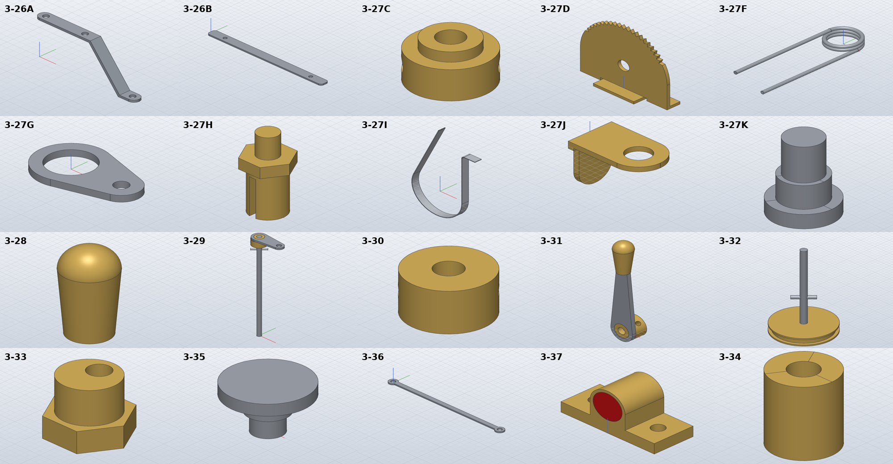

# Model the hand brake, controls and stop light

*Activity 14 · 2026-10-29*

**Twenty group 3 parts from sheet 07 were modelled: the hand brake parts, the reversing and coupling handles, the shaft adjuster and spacer, the accelerator bolt and link, and the stop light. Two SolidCraft problems came up: a cut of two picked sketch regions removed the wrong amount, and a strap's tongue could not be joined without a retry.**

## Aim

Sheet 07's upper half holds the rest of group 3 apart from the folded sheets: 3-26B and the hand brake set 3-27A to 3-27K, the reversing handle and spindle (3-28 to 3-30), the coupling handle and pulley (3-31, 3-32), the shaft adjuster and spacer (3-33, 3-34), the accelerator bolt and connector (3-35, 3-36) and the stop light 3-37. Most are small turned or flat parts.

Done meant the usual check. 3-27B and 3-27E were left for later: their side views needed a closer read.

## Tools

| Tool | Version | Used for |
| --- | --- | --- |
| `pdftocairo -svg`, line listings | poppler / session | Sheet 07's vectors (43,668 segments); the steps of 3-27K and 3-35 |
| SolidCraft `solvecraft-cli` | repo build | `solid.coil`, `solid.sweep`, `appearance.assign`, step-by-step evaluation |
| Python | 3.13 | `gen_parts.py`; `link()` gained a base height for 3-29's crank |

## Process

### 1. Reading the small parts

The two screws were read from their vertical lines. For 3-27K they lie at x = 791.7 … 848.6 pt: at 1:1, a Ø7 × 2 head, a Ø5 × 3.3 shoulder and an M4 × 5 end. 3-35 has a Ø8 × 1.5 head, a Ø4 × 2.1 shoulder and M3 × 2.5. The other parts are fully dimensioned. Examples: 3-27D, a toothed brass plate with three bent feet; 3-33, a 12 AF hex with an eccentric Ø4 bore; 3-37, a stop light housing with a red lens.

### 2. Material names and multi-body parts

3-27F, the release spring, is a coil plus two legs. Its first build stopped before any geometry:

```text
3-27F: FAIL error: step 4 (material.assign): invalid parameters for `material.assign`: `bodies` must list existing bodies
```

The legs are separate bodies, so the part needs a material per body (`{"coil": "Steel", "leg 1": …}`). The stop light's lens is a second body in polycarbonate, coloured with `appearance.assign … color="#d01818"`.

### 3. The strap and a wrong cut

3-27J is a 1 thick strap: a tab with an R4 end round a Ø4 hole, and a round-ended tongue bent down 10. Joining the tongue to the tab needed a separation retry:

```text
3-27J: FAIL … SolidCraft 134.7 (-0.00 %)
   Tongue: Boolean retry: temporary coincident-face separation up to 3.123144e-1 mm per face
```

It was rebuilt as one L section 8 wide, trimmed afterwards. That gave a wrong volume (+4.63 %). Stepping through the build showed the cause:

```text
003.json [176.0] []
009.json [162.85] ['Boolean retry: tool displacement 3.673485e-5 mm, …']
016.json [141.98] […]
```

The tab-end cut removed 13.15 mm³ instead of 19.44. That cut picked two regions of one sketch by points, a rectangle less a circle and the smaller hole circle inside it. Done as two cuts, both are right:

Output: `3-27J: OK 1/1 bodies, hand volume 135.7 mm³, … SolidCraft 135.7 (-0.00 %)`

### 4. A collar half a millimetre off

3-31, the coupling handle, failed twice. First its cross hole had no target body, so the cut had nothing to act on (`through all needs a body to cut`). With the target set, it built but read 1.48 % high. The cause was a modelling slip: the collar's Ø12 part started 0.5 inside the lever, so the lever and the Ø12 overlapped where the hand calculation assumed they did not. The spigot now reaches 0.5 into the Ø12, and the Ø12 starts at the lever's face:

Output: `3-31: OK 3/3 bodies, hand volume 2118.3 mm³, … SolidCraft 2118.1 (-0.01 %)`

### 5. The brake band

3-27I is a stainless band bent into a loop: an R23 bottom, one leg straight up 48.5 into a 12 tab, the other leg to a tip 64.2 above the loop's centre. It is a `solid.sweep` of a 6 × 0.5 section along a path of lines and arcs. It checks exactly (602.6 mm³), but its length comes to about 201 mm, where the drawing says "stretched length approx 175". The drawn shape was followed and the difference noted in the README.



*Figure 1 — The sheet 07 group 3 parts*

> 3-27D's teeth run over ±63° above its Ø4 hole; 3-27F's legs leave the coil tangentially; 3-27I is the band's loop with its tab. 3-29's crank sits on top of its 111 long spindle, and 3-37 shows the red lens in the brass housing.

## Results

Pushed as `febd50c`: 3-26B, 3-27A, 3-27C, 3-27D, 3-27F to 3-27K and 3-28 to 3-37.

- All within 0.04 % (3-27F within its 1 % allowance for a 0.5 wire).
- A sixth SolidCraft problem was documented: cutting two point-picked regions of one sketch can remove the wrong amount.

### Limits and what was left

- The thicknesses of 3-27G and 3-36 (1.5) are not dimensioned; 3-29's hub height and 3-32's pin position are measured.
- 3-27I's drawn shape is longer than its stated stretched length; its copper lining is not modelled.
- 3-27B and 3-27E were done later (activity 16).

---

*Written retrospectively from the session transcript*
