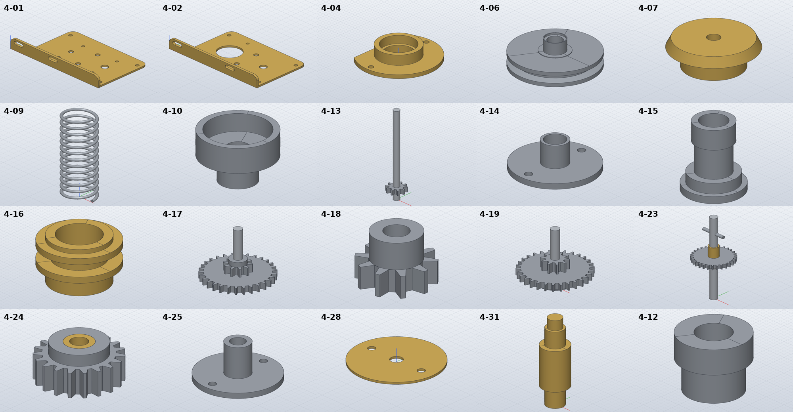
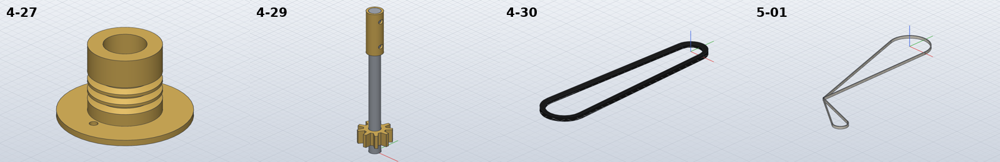

# Model the gearbox, coupling and belts

*Activity 15 · 2026-10-29*

**Twenty-eight group 4 parts and the 5-01 belt were modelled from sheets 07, 08 and 11. The gears were built prisms first, because SolidCraft could not join a tooth prism to a round hub it touched. The volume check caught a V-belt whose tangent points were on the wrong side.**

## Aim

Group 4 is the gearbox and coupling unit: two brass side plates, spacers, bearings, the coupling pulleys, plate, spring and retainers, the cluster gears and spacers, and the reversing rack and pinion. 5-01 is the nylon belt. Most are on sheet 07; the rack, the pinion and the V-belt are on sheet 08, and 5-01 on sheet 11.

Done meant the usual check, with part names taken from the parts list.

## Tools

| Tool | Version | Used for |
| --- | --- | --- |
| `pdftotext -layout` | poppler | Group 4 names from sheet 02 |
| `pdftoppm -r 700/900` | poppler | Zoomed renders of the 4-06, 4-10 and 4-15 sections |
| SolidCraft `solvecraft-cli` | repo build | `solid.coil`, `solid.sweep`, gear prisms, step evaluation |
| Python | 3.13 | `gen_parts.py`: `gear_points`, `gear_prism`, `cluster_gear` helpers |

## Process

### 1. Names first

The parts were first written with descriptive names, then checked against the parts list, which renamed eight of them:

```bash
pdftotext -layout …/478a0380-lanz-a3-sheet-02.pdf - | grep -oE "[0-9]+ +LANZ-4-[0-9]+[A-Z]?-[A-Z0-9 ./-]*"
```

Output (start): `1 LANZ-4-01-GB-RH-SIDE PLATE`, `1 LANZ-4-02-GB-LH-SIDE PLATE`, `4 LANZ-4-03-GB-SIDE PLATE SPACER`, …

### 2. Side plates and sections

4-01 and 4-02 are 2 thick brass angles, with a 90 × 13 flange and a 77 × 51 plate. The plate is joined starting 1 inside the flange so the two overlap instead of sharing a face. The Ø4 holes 20 from the left shaft at ±30° are placed by trigonometry (X = 36.5 + 20 cos 30°). The coupling pulley 4-06 was read from a 900 dpi render of its section: a cup pulley 8 wide with a 20° V groove. 4-10 and 4-15 were read the same way after a first crop missed them.

### 3. Gears that would not join

The 30 tooth gears, 10 tooth pinions and their hubs make up the cluster gears 4-17 to 4-19. The first build joined straight-flanked gear prisms onto a revolved hub-and-core:

```text
4-17: FAIL error: step 9 (solid.extrude): boolean Union: … the exact fallback for where the bodies meet
(faces that touch, or cross at a shallow angle) takes planar faces only, and the target has 12 curved faces (cylinder) …
```

The prisms carried a Ø4 bore circle that lay on the core's bore, so curved faces touched. Without the bore circle the joins still failed, now at the hub's face. The working order is reversed: the prisms first (all planar), then the round hub and collar joined reaching 0.5 into them, and the bore drilled last.


*Figure 1 — 4-17 in section, in build order*

> The grey gear and pinion are extruded first. The blue hub (left) and collar (right) each overlap them by 0.5, so no round face merely touches a prism face. The collar is Ø7.9 rather than Ø8 so it stays inside the pinion's Ø8 roots. The dashed Ø4 bore is cut last through everything.

Output: `4-17: OK 2/2 bodies, hand volume 3901.4 mm³, … SolidCraft 3901.3 (-0.00 %)`

4-24's gear first measured 15.93 % high with its prism joined onto a revolved hub; rebuilt in the same order as the cluster gears, it checks exactly.



*Figure 2 — Group 4 parts*

> 4-01 and 4-02 show their slots and hole patterns; 4-04 its flat-sided flange. The cluster gears 4-17 and 4-19 carry their pinions on stainless shafts, and 4-23's gear sits between two brass sleeves with the cross pin above.

### 4. Belts as sweeps

The V-belt 4-30 is a trapezoid section (4 / 2.5 × 3) swept round two ends of R10 and R14, 101.6 apart. It built, but measured 0.42 % low. A test sweep of the same section round a symmetric loop matched its hand value to 0.008 %, so the sweep itself was fine:

```text
[1502.664227572649]
want 1502.787565803085
```

The error was in the path: the tangent points sat at −φ instead of +φ, so the straight runs were not tangent to the ends. Fixed:

Output: `4-30: OK 1/1 bodies, hand volume 2633.0 mm³, STL mesh 2633.0 (+0.00 %), SolidCraft 2632.9 (-0.00 %)`

The nylon belt 5-01 is a figure of an R16 and an R6 loop meeting at a corner. It is two open sweeps (line, arc, line), one per loop.



*Figure 3 — The rack, pinion and belts*

> 4-27's three V grooves; 4-29's brass pinion and cross-drilled sleeve on its steel shaft; the V-belt's loop; and 5-01's two loops meeting at the sharp corner.

## Results

Pushed as `6ce07ad`, `9d21a9a` and `740f52e`: 4-01 to 4-25 (except 4-26), 4-27 to 4-31 and 5-01.

- All within 0.03 % (the 0.5 wire spring 4-09 within its 1 % allowance).
- Gears and hubs now follow a fixed build order, recorded in the README.

### Limits and what was left

- Teeth are straight-flanked; the 30 tooth gear's tip and root widths are assumed.
- 4-29's shaft is drawn broken, so its length (68) is assumed.
- 4-26 (reversing shaft operating ring) was left out: its hub cannot be read unambiguously.

---

*Written retrospectively from the session transcript*
