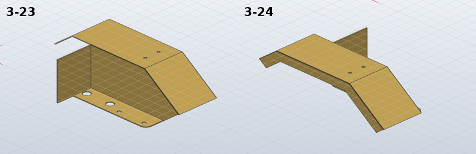

# Model the mudguards and close the set

*Activity 16 · 2026-10-29*

**The last modelled parts were added: the hand brake and release handles (3-27B, 3-27E), the seat back rest 3-25D and the two mudguards 3-23/3-24. The mudguards were built already folded from overlapping solids. Four parts the drawings do not define fully were left out by the owner's decision, closing the set at 182 of 186 listed parts.**

## Aim

3-27B, 3-27E and 3-25D were the last parts of the groups 3 to 5 work. After the report that followed, the owner said "go on" again, which meant another attempt at the folded sheet parts reported as not modelled. Last, the owner said "there is no item sheet 13, you can neglect these parts", which settled the four still open.

Done meant the usual check. The mudguards were to have their folded shape, not just a flat pattern.

## Tools

| Tool | Version | Used for |
| --- | --- | --- |
| `pdftoppm -r 500` | poppler | 4-26 re-read at high resolution |
| Sheet 10 and 09 assembly views | drawings | How the mudguard and console plate fold |
| SolidCraft `solvecraft-cli` | repo build | Overlapping slab extrusions, step evaluation |
| Python | 3.13 | `gen_parts.py`: `clip_convex`, `offset_polyline`, inclusion-exclusion of overlaps |

## Process

### 1. Two handles and the back rest

3-27B is a 2 thick lever, built from the dimensioned top view. Its first build returned a negative hand volume (−123.2 mm³): the upper tangent from the 7 wide neck to the R6 eye was taken on the wrong side. With `left=False` it checks. 3-27E is a blade 6.5 wide, its side profile read from the drawing: a top edge 50 long rising 16° to a 1.5 tip, and an R4 bottom round a Ø5 hole. Its fork slot comes from the top view. The slot's hand volume samples the profile's height along X. The wooden back rest 3-25D is a rounded block.

```text
3-27B: OK   1/1 bodies, hand volume 1134.5 mm³, … SolidCraft 1134.5 (+0.00 %)
3-27E: OK   1/1 bodies, hand volume 1618.5 mm³, … SolidCraft 1618.5 (+0.00 %)
```

### 2. Reading the mudguard

3-23 is drawn only as a 1 thick flat pattern with fold lines and notes ("FOLD DOWN 45°", "FOLD UP 90°"). Its folds run across V notches and a slanted edge, which `sheet.fold` refuses (activity 06). The assembly views on sheets 06 and 10 showed the folded shape:
- a top 44 wide between front and rear facets turned down 45°;
- a 12 wide lip down the outer edge;
- an inner side panel 59 deep, whose diagonal edge runs under the front facet (the drawing's "gusset in side");
- an end wall and a mounting flange.

The flat pattern's coordinates were checked against each other. The diagonal edge from the flange's top corner meets the right part's edge at the 45° fold line, to within 1.2 mm of the drawn 27.2 and 57.4.

### 3. Building it folded

The guard is a set of slab extrusions in the (U, Z) side plane: the facet band, the lip, the side panel, the end wall and the flange.


*Figure 1 — 3-23's pieces seen from the side*

> The black band is the top with its two 45° facets, 1 thick. The blue band below it is the 12 deep lip at the outer edge. The grey panel is the inner side, its sloped edge just under the front facet. The end wall stands at its back, and the mounting flange lies at its foot.

The first build had pieces sharing faces, and two joins needed separation retries:

```text
   Lip: Boolean retry: temporary coincident-face separation up to 3.723779e0 mm per face
   Flange: Boolean retry: refined tolerance 1.034266e0 mm; temporary coincident-face separation up to 4.186824e0 mm per face
```

Every piece was then moved so it overlaps its neighbours by 0.5 instead of touching. The hand volume adds the pieces and subtracts the overlaps by inclusion-exclusion. The side panel's overlap with the bent facet band is computed by clipping the panel's outline against each facet's quadrilateral (a new `clip_convex` helper), since no polygon library is used.

*The overlaps, as subtracted and added back*

```python
v -= a_bs * 0.5 + 0.5 * 0.7 * 58 + 1 * 0.2 * 0.5 + 87.5 * 0.25 + 0.5 * 21.5 * 0.5
v += 0.5 * 0.2 * 0.5 + 0.5 * 0.5 * 0.5
```

Output: `3-23: OK 1/1 bodies, hand volume 18882.3 mm³, STL mesh 18883.3 (+0.01 %), SolidCraft 18882.4 (+0.00 %)`

3-24 is the same function with Y reversed, including the flange's arc direction.



*Figure 2 — The two mudguards*

> 3-23 shows the inner side panel with its flange and four holes, and the end wall. 3-24, its mirror, shows the outer lip following the facets.

### 4. What stayed out

A 500 dpi render of 4-26 still did not settle its hub. The side view shows a 14 high hub, a Ø10 bore and a 6 wide slot, while the end view's Ø18 circle fits none of them. 3-20's flat pattern does not show which regions fold which way. 3-25C has too few views of its bends, and 2-11 has no length or rod positions. The owner confirmed there is no further sheet and that these may be left out. The README records them as left out by that decision.

## Results

Pushed as `85ffd4c`, `b9f32e8` and `3f6c040`. `parts/summary.json` lists 183 parts: 182 of the 186 in the parts list, plus 1-53.

- All within 0.01 % of their hand volumes.
- The mudguards are folded solids, each checked exactly.

### Limits and what was left

- The mudguards' bends are sharp and the lip's R10 ends are not rounded; the fold directions are read from 3D views.
- 3-27E's fork slot is taken right through the blade; 3-25D's edge rounds and bend are not modelled.
- 2-11, 3-20, 3-25C and 4-26 are not modelled, by the owner's decision.

---

*Written retrospectively from the session transcript*
