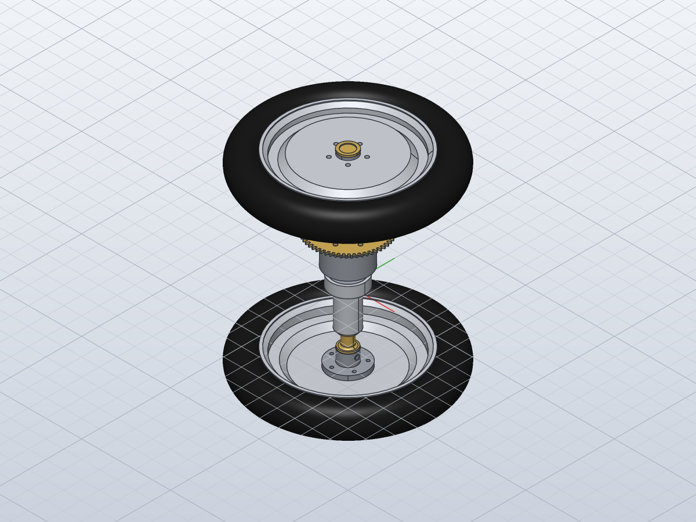

# Set up the assembly method and build the rear axle

*Activity 18 · 2026-10-30*

**A generator for subassemblies was written: it links the part designs and places each occurrence from how the parts mate. The first subassembly, the 25-part rear axle with differential and wheels, closes exactly along its axis. The work also found that `occurrence.move` composes with the current placement, and that 3-04's cross hole must pass through both walls.**

## Aim

The owner asked to "create assembly from parts" and chose subassemblies first: build the drawn subassemblies one at a time, each checked, then combine them. The assembly sheets (08 to 11) show the subassemblies only as 3D views without positions. So every part's place had to be worked out from how it mates: shafts in bores, shoulders on shoulders, holes on holes.

The rear axle (sheet 10's SA-3-315) came first. Almost all its parts share one axis, so it could test the method.

## Tools

| Tool | Version | Used for |
| --- | --- | --- |
| `component.insert_design` | repo build | Linking a part's design as a component and occurrence |
| `occurrence.move` | repo build | Placing an occurrence by a 3 x 4 matrix |
| `inspect.interference` | repo build | Overlap check between all bodies |
| `component.list` | repo build | Reading the occurrences' actual placements |
| `gen_assemblies.py` | new, session | One function per subassembly; writes, builds, checks and renders |

## Process

### 1. How occurrences are named

A two-part test showed what a script gets back:

```text
"name": "3-04", "occurrence": 2, … "path": ".../parts/3-04.solvecraft"
…  "id": 2, "name": "3-04:1"
```

Occurrences are named `<part>:<n>`, so later commands can address them. The generator's `place(part, R, t, note)` inserts the design and moves the occurrence to x_world = R x_part + t. Every call carries a note saying which fit fixes it.

### 2. Reading the stack

The parts' own profiles (from `gen_parts.py`) gave every axial size. The chain was built outward from the differential housing 3-04 at Z 0:
- 3-03 is turned over, its Ø42 spigot in 3-04's cavity, flange on flange at Z 52;
- the bevel side gears 3-10 sit on the cross shaft at Z 37, which is 15 from 3-04's flange face;
- each axle's shoulder sits on its side gear's hub;
- each axle's cross pin sits in 3-14's cross hole;
- the bearings and spacers sit between the housings and 3-14.

A first estimate put the side gears by their pitch apex: 5.09 from the cross shaft, from the tooth sizes. That left the spacer 3-13 overlapping 3-14's hub by 1.42. Trying instead the hub bottoming on the Ø14 bore's step (Z 16) gave an apex distance of 6.51. With that, every other fit closed exactly:

```text
lower: shoulder 16 → 3-14 hub end at -60.5 = spacer end -60.5
upper: shoulder 58 → 3-14 hub end at 107.5 = spacer end 107.5
planet: 6.51 + 14.49 = 21.0 = the Ø42 cavity's radius
```


*Figure 1 — The parts along the axle, Z in mm*

> Each box is a part's extent along the axle. The blue side gears' hubs end on the steps at 16 and 58. The 3-14 hubs meet the spacers at −60.5 and 107.5 with no gap or overlap. Several separately read sizes agree here, which is the main evidence the stack is right.

### 3. Three of 3-04's sizes, and one fix

The 3-11 cross shaft is 45.5 long, about the Ø46 body's diameter, so it runs through both walls. 3-04's hole had been modelled in one wall only. The part was corrected and rebuilt:

```python
s.holes("Ø6 cross hole", (25 * u[0], 25 * u[1], 0), (-u[0], -u[1], 0), [(25 * u[0], 25 * u[1], 37)], 6, depth=50)
```

Output: `3-04: OK 1/1 bodies, hand volume 20573.6 mm³, STL mesh 20564.1 (-0.05 %), SolidCraft 20573.4 (-0.00 %)`

### 4. The first build: second copies misplaced

The first build reported one odd overlap, the bearing housing 3-05 against a side gear. Yet the two are far apart.

```text
SA-3-315: 25 occurrences, 1 overlapping pairs
   3-05 Rear axle main bearing housing part-1 / 3-10 Differential gear wheel (3-10:2): 9.05 mm³
```

The render showed the upper tyre at the middle of the axle. `component.list` gave the actual placements:

```text
3-07 3-07:2 … [0.0, 0.0, 64.0, 1.0]      asked for Z 62
3-13 3-13:2 … [0.0, 0.0, 28.0, 1.0]      asked for Z 88.5
3-14 3-14:2 … [0.0, 0.0, 216.0, 1.0]     asked for Z 131.5
```

`occurrence.move` applies its matrix on top of the current placement. A second copy inserted with `reuse` starts where the part's first occurrence is. So every second copy had been moved from the first one's place.


*Figure 2 — What was asked, what came back, and the correction*

> Each "got" value is the asked placement composed with the first copy's: 62 + 2 = 64, and so on. The generator now moves a reused occurrence by D·F⁻¹, where F is the first copy's placement and D the wanted one.

### 5. The checked result

The interference check ran out of its default 240 s budget, which left many pairs unchecked, so the budget was raised to 1800 s.

```text
SA-3-315: 25 occurrences, 0 overlapping pairs
   not checked: 3-04 Differential housing part-2 / 3-11 Differential gear wheel shaft: not verified: … could not be intersected
   not checked: 3-09B Rear axle-2 / 3-14 Rear wheel mounting plate: not verified: …
   not checked: 3-10 Differential gear wheel / 3-10 Differential gear wheel (3-10:3): … boolean Intersect: … no result
   not checked: 3-15 Rear wheel rim / 3-16 Rear wheel tyre: … no result
```

The unchecked pairs are exact fits: a shaft in its own size of hole, an axle in a bore, a tyre on its rim floor. They also include the three untoothed bevel blanks against each other.



*Figure 3 — SA-3-315 as built*

> The wheels sit at both axle ends with their hub caps. Between them are the bearing housings and the brass drive gear on the differential, as on sheet 10's SA-3-315 view.

## Results

- `gen_assemblies.py` writes and builds each subassembly to `assemblies/<name>.json`, `.solvecraft` and `.png`. It reports overlaps and unchecked pairs.
- SA-3-315 places 25 occurrences with no overlap among the checked pairs, and its stack closes exactly.
- 3-04's cross hole now passes through both walls.

### Limits and what was left

- The 3-02 axle brackets and the brake band (3-27I/J) belong with the chassis and are not placed yet.
- The bevel gears are blanks; their mesh cannot be checked.

---

*Written retrospectively from the session transcript*
