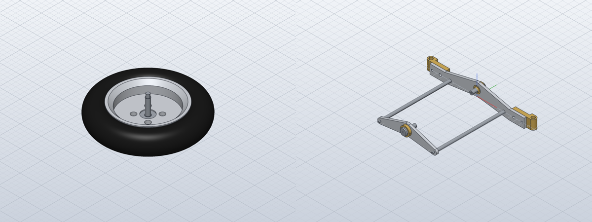

# Build the front wheel and the front axle yoke

*Activity 19 · 2026-10-30*

**The front wheel (SA-2-206) and the front axle yoke (SA-2-202) were built from their parts. In the wheel, the cap's spigot and the bearing fill the rim's counterbore exactly. In the yoke, the two arms' hole patterns put both bearings on one axis. Neither has overlapping parts.**

## Aim

After the rear axle, the owner said "go on". The next subassemblies taken were the two on the front axle: the wheel (rim, tyre, hub cap, bearing and axle) and the yoke that carries the wheels (two arms, two tie rods, two bearings and two hinge brackets).

Done meant the same as for the rear axle. Every placement comes from a fit, the interference check passes, and the render matches the 3D views on sheet 09.

## Tools

| Tool | Version | Used for |
| --- | --- | --- |
| `gen_assemblies.py` | session | The two new subassembly functions |
| `inspect.interference` | repo build | Overlap check |
| Sheet 09 assembly views | drawings | Checking the arrangement by eye |

## Process

### 1. The wheel's stack

The rim 2-31's hub has a Ø16 counterbore 9 deep from its hub face, ending on a Ø14 step. The parts that go into it are:
- the hub cap 2-33, whose Ø16 spigot is 1 high;
- the bearing 2-29, Ø16 × Ø6 and 8 wide;
- the wheel axle 2-28, a Ø8 × 2 head followed by a Ø6 × 8 section.

The spigot (1) and the bearing (8) together fill the counterbore's 9 exactly. The axle's Ø6 × 8 matches the bearing's width. Its Ø8 head fits the cap's Ø14 recess, which is 2.5 deep.


*Figure 1 — The hub in half section*

> The cap's spigot (top) sits at Z 0 to 1, the dark bearing at Z 1 to 9 against the Ø14 step, and the blue axle's Ø6 section exactly fills the bearing. Nothing here needed an assumption: every size is dimensioned.

The cap is turned 45° so its Ø3 holes sit on the rim's M3 holes. Those were placed at 45° when the rim was modelled, to keep them off the revolve's seam (activity 10). The tyre sits on the rim's Ø62 floor.

*The wheel's placements, as written in the generator*

```python
a.place("2-31", note="base: hub face at Z 0")
a.place("2-33", matmul(rot_z(45), FLIP_X), (0, 0, 1), "spigot in the Ø16 counterbore, flange on the hub face")
a.place("2-29", I3, (0, 0, 1), "in the counterbore under the cap's spigot, against the Ø14 step")
a.place("2-28", I3, (0, 0, -1), "Ø6 x 8 in the bearing, head in the cap's recess")
```

Output: `SA-2-206: 5 occurrences, 0 overlapping pairs`

### 2. The yoke's geometry

The front arm 2-20 and the rear arm 2-18 are tied by two rods 2-19, each Ø5 × 118.5 with M3 × 7 ends. Three sets of matching sizes fix the layout:
- **The rods.** Both arms have Ø3 holes at X ±47. The rods go through them, so the arms are parallel, 118.5 apart between their inner faces.
- **The bearings.** 2-18's Ø12 is 10 above its rod holes, and 2-20's Ø12 is also 10 above its hole line. With the rod holes level, the two Ø12 holes share one axis, so both bearings 2-21 sit on the yoke's pivot. Each bush's 4.1 spigot fills a 4 thick arm.
- **The hinge brackets.** Each 2-22 has an M4 and an M3 hole 14 apart. These land on 2-20's Ø4 at 64.5 and Ø3 at 78.5, so each bracket's eye lies beyond the arm's end, vertical, ready for the wheel's pivot axle.

The world axes are X across, Y forward and Z up. The arms stand upright, so their parts' X stays X, their Y becomes up and their thickness runs fore and aft. The generator's `frame()` builds these rotations from the three target directions:

```python
up_front = frame((1, 0, 0), (0, 0, 1), (0, -1, 0))  # part X across, part Y up, part Z backward
a.place("2-20", up_front, (0, 4, 0), "front arm: rear face on Y = 0, hole line on Z = 0")
a.place("2-18", up_front, (0, -118.5, 10), "rear arm: front face on Y = -118.5, its holes on Z = 0")
```

### 3. The result

```text
SA-2-202: 8 occurrences, 0 overlapping pairs
   not checked: 2-21 pin / 2-21 bush: the operation failed: boolean Intersect: the operation failed: no result
```

The rods passing the arms without overlap confirms they go through the holes. The unchecked pairs are each bearing's pin against its own bush, an exact Ø8 fit.



*Figure 2 — The front wheel (left) and the front axle yoke (right)*

> The wheel shows the axle coming through the web. In the yoke, 2-20's raised centre is up, with the two tie rods behind it to 2-18. The brass hinge brackets with their vertical eyes are at 2-20's ends, and the brass bearings in both Ø12 holes.

## Results

- SA-2-206 (5 occurrences) and SA-2-202 (8 occurrences), both with no overlaps.
- Every placement in the wheel follows from dimensioned sizes.

### Limits and what was left

- That the hinge brackets sit on 2-20's front face rather than its back is read from sheet 09's 3D view, which does not show it clearly. The generator's docstring says so.
- The wheels are not yet joined to the yoke: that needs the pivot axle 2-23 and the steering parts (2-24 to 2-26), still to come.

---

*Written retrospectively from the session transcript*
