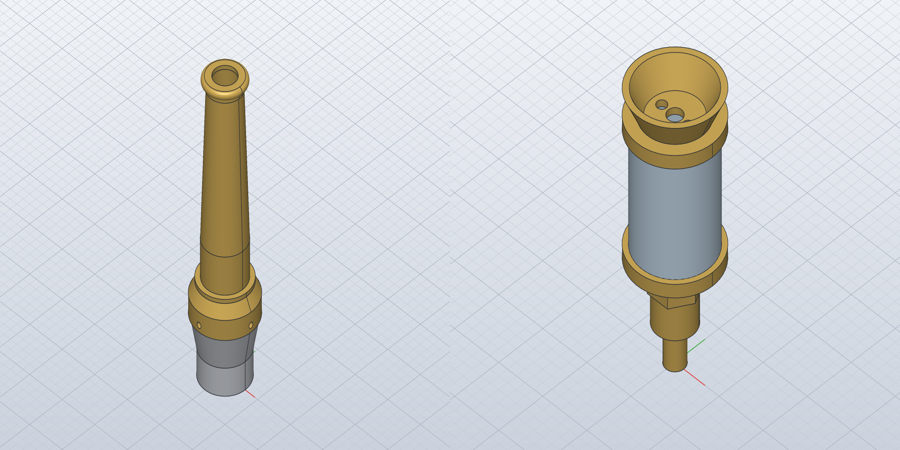
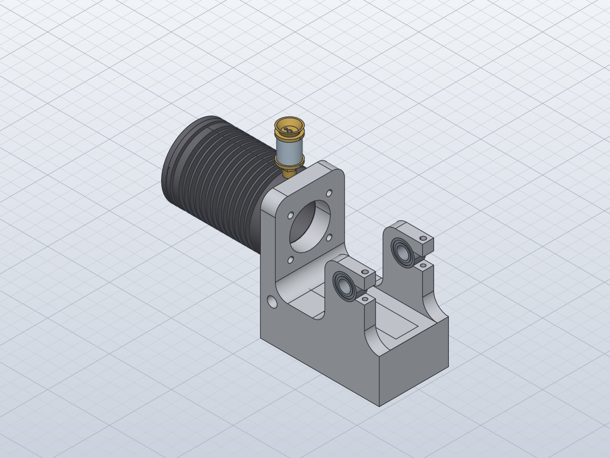

# Build the exhaust stack, the oiler and the engine block

*Activity 20 · 2026-10-30*

**Three engine subassemblies were built: the exhaust stack (SA-1-110), the cylinder oiler (SA-1-102), and the engine block (SA-1-101), which links the finished oiler as a nested subassembly. Their only overlaps are threads, which are modelled at full diameter in tap-drill holes.**

## Aim

Before the gearbox, whose layout along each shaft is uncertain, the subassemblies whose fits were already confirmed when the parts were modelled were taken first. In activity 05 the exhaust parts were found to fit each other. The oiler's parts are one stack on one axis.

The engine block came next: frame, cylinder, gasket, heads and crankshaft bearings. It also tested a nested subassembly, which is how the whole tractor will later be put together. Done meant the usual: placements from fits, the interference check, and a match with sheet 08's 3D views.

## Tools

| Tool | Version | Used for |
| --- | --- | --- |
| `gen_parts.py` (read only) | session | The parts' profiles: bores, bolt patterns, frame axes |
| `gen_assemblies.py` | session | Three new functions; `place(…, sub=True)` for nesting |
| `inspect.interference` | repo build | Overlap check |

## Process

### 1. The exhaust stack

The fits were the ones found in activity 05:
- the base ring 1-37's Ø33 × 7 counterbore goes over the bracket 1-36's Ø33 × 7 band (Z 31 to 38), its Ø3 holes level with the bracket's M3 holes;
- the stack 1-38's Ø33 flange sits on the ring's Ø33 cone top (Z 47), its Ø24 bore continuing the bracket's;
- the top ring 1-39's 4 deep Ø19 bore goes over the stack's Ø19 × 4 band (Z 143).

Output: `SA-1-110: 4 occurrences, 0 overlapping pairs`

### 2. The oiler

Three fits stack the oiler:
- the glass base 1-08's M6 screws into the oiler base 1-07's M6 hole, its flange on the hex (Z 15.5);
- the glass 1-09 stands in 1-08's Ø15 × 1 recess;
- the top 1-10's Ø15 × 1 recess caps the glass.

```text
SA-1-102: 4 occurrences, 1 overlapping pairs
   1-07 Motor cylinder oiler base / 1-08 Motor cylinder oiler glass base: 48.69 mm³ at [0.0, -0.0, 12.3]
```

Most of the overlap is expected. Threads are modelled at their major diameter and tapped holes at the tap drill, so the M6 (Ø6) in its Ø5 hole over 5 mm gives π/4 (36 − 25) × 5 = 43.2 mm³. The rest, about 5 mm³, comes from 1-08's Ø4 nozzle reaching about 1 below the 8 deep tapped hole. That is a small conflict between two read sizes, recorded in the generator.



*Figure 1 — The exhaust stack (left) and the oiler (right)*

> The exhaust stack shows the aluminium bracket, the brass ring with its screw holes, the tapered stack and the beaded top ring. The oiler shows the glass between its two brass bases, with the funnel top and its feed holes.

### 3. The engine block

The frame 1-01 was modelled in its own axes: X along the engine, X 0 on the cylinder upright's outer face, Z up, the cylinder axis on Z 70. Its code gave the parts' places:

```python
DCB = s.param("frame_cyl_bore", 33, "cylinder spigot bore in the upright")
PCD = s.param("frame_pcd", 44, "4 x Ø4.5 on PCD 44 at 45 deg (cylinder bolts)")
XB = s.param("frame_crank_x", XK1 - 16, "crankshaft bore position, 16 from the cheek's outer face")
DCK = s.param("frame_crank_bore", 19, "crankshaft bearing bore (1-06 bearings)")
```

- **Cylinder.** The cylinder 1-02 has M4 holes on the same PCD 44 at 45° at both ends. It bolts to the upright's outer face on that pattern. Its 9 mm flange, the one with the radial oiler hole, goes against the frame with the hole up. The rotation maps the cylinder's Z to the engine's X and its X up.
- **Gasket and heads.** The gasket 1-03's Ø32 spigot goes into the bore's outer end. Then come the inner head 1-04, countersunk face in and valve channel out, and the outer head 1-05, all on the same bolt pattern.
- **Crankshaft bearings.** The bearings 1-06, 9 wide, fill the 9 thick cheeks' Ø19 bores at X 68.
- **Oiler.** The finished oiler is linked as a component: its stud enters the cylinder's oiler hole, 4.5 from the flange's end, with its collar on the flange at Z 98.

*Nesting a finished subassembly: the generator's `place` gained a `sub` flag*

```python
path = f"{part}.solvecraft" if sub else os.path.join(PARTS, f"{part}.solvecraft")
a.place("SA-1-102", I3, (-4.5, 0, 92), "stud in the cylinder's oiler hole, collar on the flange", sub=True)
```

```text
SA-1-101: 8 occurrences, 2 overlapping pairs
   1-02 Motor cylinder / 1-07 Motor cylinder oiler base: 23.96 mm³ at [-4.5, -0.0, 95.0]
   1-07 Motor cylinder oiler base / 1-08 Motor cylinder oiler glass base: 48.69 mm³ at [-4.5, -0.0, 104.3]
```

The first overlap is the oiler's M4 stud (Ø4) in the cylinder's Ø3.3 tap drill: π/4 (16 − 10.89) × 6 = 24.1 mm³ against 23.96 measured. The second is the oiler's own thread, carried in with the nested subassembly.



*Figure 2 — SA-1-101 as built*

> The finned cylinder stands on the upright's outer face with the oiler on top. The cylinder bore shows through the upright's Ø33 hole, and the two crankshaft bearings sit in the cheeks' clamped bores. This matches sheet 08's SA-1-101 view.

## Results

- SA-1-110 (4 occurrences, no overlaps), SA-1-102 (4, thread only) and SA-1-101 (8, threads only).
- Finished subassemblies can now be nested, which the crankshaft (activity 21) and the whole tractor will use.

### Limits and what was left

- The oil channel and valve (1-11 to 1-13), the valve gear and the flame guards are not placed in the block yet.
- The oiler's nozzle depth conflict (about 1 mm) is noted, not resolved.

---

*Written retrospectively from the session transcript*
