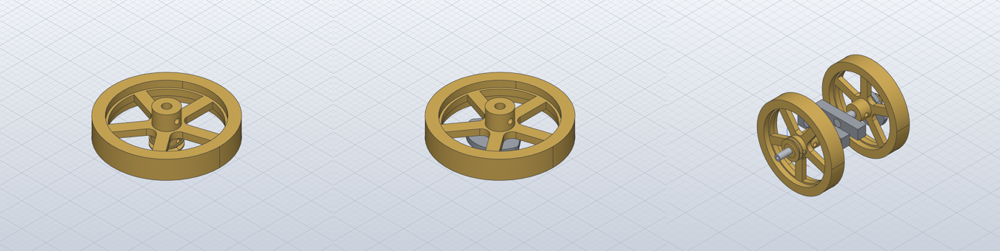

# Build the flywheels and the crankshaft

*Activity 21 · 2026-10-30*

**The two flywheel subassemblies (SA-1-103 with the drive pulley, SA-1-104 with the cam plate) and the crankshaft carrying both (SA-1-105) were built in the engine block's axes. With the hub's collar 2 clear of the frame cheek, the hub's grub screw lands exactly on the crankshaft's cross hole, which confirms the placement.**

## Aim

The crankshaft and flywheels come next in the engine. Sheet 08 shows them as three subassemblies:
- SA-1-103: a flywheel on its hub with the drive pulley;
- SA-1-104: a flywheel on its hub with the cam plate and lock nut;
- SA-1-105: the crankshaft with both.

Done meant the usual. In addition, SA-1-105 was built in the same axes as the engine block (SA-1-101), so the two can be combined without moving either.

## Tools

| Tool | Version | Used for |
| --- | --- | --- |
| `gen_parts.py` (read only) | session | Hub, flywheel, crank, pulley, cam and nut sizes |
| `gen_assemblies.py` | session | Three new functions; the flywheels nested in the crankshaft |
| `inspect.interference` | repo build | Overlap check |

## Process

### 1. The sizes that decide

The hub 1-20's code gave its layout:

```python
LT = s.param("hub_thread_l", 19.5, "threaded part (thread 14 long)")
LC = s.param("hub_collar_l", 15, "collar length")
Z6 = s.param("hub_m6_z", LT + LC - 8, "M6 grub screw, 8 from the collar end")
```

The flywheel 1-21 is 19 wide, with a Ø16 bore. At first that seemed to take up the whole thread. But only its web, 6 thick in the middle, carries the bore: the rim extends 6.5 beyond the web on each side. So the web sits on the thread against the collar (hub Z 13.5 to 19.5), and the 13.5 of thread left is for the pulley or the cam plate.

### 2. The two flywheels

- **SA-1-103.** The drive pulley 1-15 (12.5 long) screws on against the web, boss first.
- **SA-1-104.** The cam plate 1-17 (5 thick) screws on against the web, its Ø19 counterbore outward. The lock nut 1-18's Ø19 collar enters that counterbore and stops on its floor at hub Z 11. The collar (3) is 0.5 longer than the counterbore is deep (2.5), so the nut's hex stands 0.5 off the cam.


*Figure 1 — What sits where on the hub, Z from its threaded end*

> The web takes the last 6 of the thread before the collar. On SA-1-103 the pulley fills Z 1 to 13.5. On SA-1-104 the cam fills 8.5 to 13.5 and the nut 3 to 11, its collar inside the cam's counterbore. The dashed line is the M6 grub screw at 26.5, used in step 3.

```text
SA-1-103: 3 occurrences, 0 overlapping pairs
   not checked: 1-20 Motor flywheel hub / 1-15 Motor crank shaft drive pulley: … boolean Intersect: … no result
SA-1-104: 4 occurrences, 0 overlapping pairs
```

The unchecked pairs are the M16 threads in their Ø14 tap drills, which the kernel could not intersect.

### 3. The crankshaft and the confirming fit

The crankshaft 1-14 is built symmetric about its crankpin, with journals at |Z| 18 to 28.5. In the engine block's axes its axis is Y at X 68, Z 70. Its journals then fall in the bearings, which span |Y| 19 to 28.

The hubs go on the Ø8 shafts outside the frame. They cannot pass the Ø9.5 journal, which ends at |Y| 28.5. The frame cheeks end at |Y| 28. Taking each hub's collar 2 clear of the cheek (|Y| 30) puts the hub's M6 grub screw at:

```text
hub collar end at Y -30 → M6 grub at hub Z 26.5 → world Y = -64.5 + 26.5 = -38
crankshaft cross hole: -(18 + 10.5 + 9.5) = -38
```

The grub screw lands exactly on the left shaft's Ø4 cross hole, and both lie along X. A grub screw keyed into a cross hole is how such a hub is fixed, so this confirms the hub's position.

The crankpin is placed at top dead centre, toward the cylinder. The cam plate is taken on +Y and the pulley on −Y, because the drawings do not show clearly which side carries which.

```python
a.place("1-14", frame((-1, 0, 0), (0, 0, 1), (0, 1, 0)), (68, 0, 70), "journals in the 1-06 bearings")
a.place("SA-1-104", frame((1, 0, 0), (0, 0, 1), (0, -1, 0)), (68, 64.5, 70), "hub collar at Y 30", sub=True)
a.place("SA-1-103", frame((1, 0, 0), (0, 0, -1), (0, 1, 0)), (68, -64.5, 70), "hub collar at Y -30, grub on the cross hole", sub=True)
```

```text
SA-1-105: 3 occurrences, 0 overlapping pairs
   not checked: 1-14 shaft R / 1-20 Motor flywheel hub: not verified: the bodies' facets pass through each other by more than 4.500000e-2 mm, but they could not be intersected
```



*Figure 2 — The flywheel with pulley, the flywheel with cam, and the crankshaft with both*

> In the crankshaft view (right) the flywheels' rims span |Y| 38.5 to 57.5, clear of the frame's half-width of 28, which is not drawn here. The pulley is on the near flywheel's outer face and the crank webs are between the hubs.

## Results

- SA-1-103 (3 occurrences), SA-1-104 (4) and SA-1-105 (3, nesting both), with no overlaps among the pairs that could be checked.
- SA-1-105 is in the engine block's axes, ready to combine with SA-1-101.
- With these three, nine subassemblies were committed and pushed before the owner asked for the pull request.

### Limits and what was left

- Which flywheel carries the cam and which the pulley, and the crank angle, are assumptions.
- The piston, connecting rod, valve gear and flame guards remain. So do the complete engine (SA-1-115), the gearbox, the console, the seat and the whole tractor.
- The gearbox's side plate 4-02 must first be remodelled as a true mirror of 4-01: as modelled, the two plates' holes cannot all line up.

---

*Written retrospectively from the session transcript*
